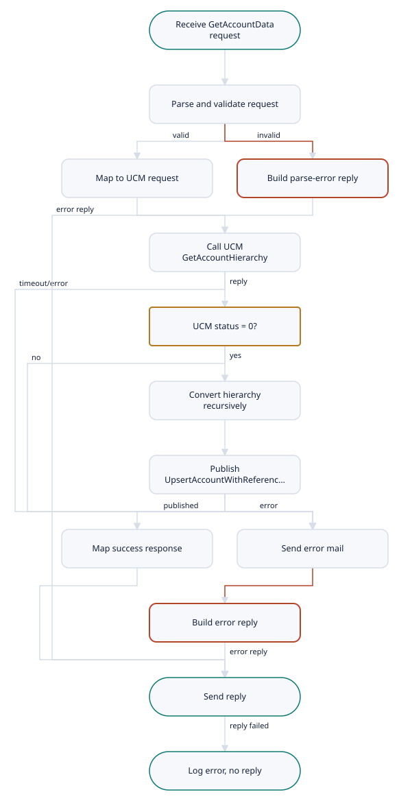

# CRMServices.GetAccountData (1054)

Demo-TIBCO-CMRService-Project · Listener · complex complexity

[← All interfaces](../../Extraction_Report.md)

- [Interface Overview](#interface-overview)
- [Interface Summary](#interface-summary)
- [Functional Analysis](#functional-analysis)
- [Technical Analysis](#technical-analysis)
- [Mappings](#mappings)
- [Business Rules](#business-rules)
- [Flow Diagram](#flow-diagram)
- [Data Model](#data-model)
- [Architecture](#architecture)

---

## Interface Overview

A synchronous request/reply service (KPN EAI service 1054 'GetAccountData', contract 0418). Given a Siebel account ID, it retrieves the account's complete hierarchy from UCM through UCMAdapter (GetAccountHierarchy, service 0419) and publishes that hierarchy as an 'UpsertAccountWithReferencing' event (contract 0420). That event triggers the account to be written to SFA and its references registered in UCM. The caller receives only a status: the account data itself is not returned.

| Field | Value |
| --- | --- |
| Interface | CRMServices.GetAccountData (1054) |
| Type | Listener |
| Complexity | complex |
| Components to build | 13 |
| Mapping rules | 38 |
| Business rules | 7 |

## Interface Summary

GetAccountData is the starting point of the account synchronisation. A calling application sends a Siebel account ID. CRMServices asks UCM, through UCMAdapter, for the account's whole hierarchy (the account, its child accounts at any depth, their contacts, affiliations and business addresses), converts it into the CRMServices publication format, and publishes it on the message bus for the UpsertAccountWithReferences flow to process. The caller receives a reply that reflects UCM's status: success, or UCM's error code and description.  If UCM reports an error, nothing is published and the caller receives UCM's error. A technical failure (bad request, timeout, publishing error) produces a 'Technical Error' reply and an e-mail to integration support.  Three things make this interface complex to move to Boomi. The service and its call to UCM both run over TIBCO Rendezvous, which Boomi cannot connect to, so a transport decision is needed first. The account hierarchy is recursive (accounts contain accounts) and must be converted by a script, because Boomi maps cannot recurse. And the message header and status schemas, plus the helper code that reads message IDs, are in a TIBCO library that was not exported.

**Complexity:** complex (score 72)

## Functional Analysis

1. **Receive request** — RV Subscriber on %%Env%%.FIXED.CRM.%%CRMServices/ComponentId%%.Request.GetAccountData.1 via RVCMQ transport. The body is the XML text in RV field 'xml'; the reply subject is captured.
2. **Trace request (optional)** — If eai:isTraceOn('EAI-04005') is true, log the send subject, reply subject and body via Common Sub\_Trace (MsgId from eai:getMessageId).
3. **Parse and validate request** — Parse the text as GetAccountDataRequest with validateOutput = true.
4. **Build UCM request** — Build GetAccountHierarchyRequest: CMH ID '1054', NAME 'GetAccountHierarchy', MID '1054.20', DESTINATION from Env and UCMAdapter ComponentID; BODY/SIEBEL\_ACCOUNT\_ID copied. Main\_GetAccountdata first builds an intermediate CMH with ID '1055', which Sub\_GetAccountdata replaces.
5. **Call UCM GetAccountHierarchy** — Common Sub\_Requester request/reply, timeout CRMServices/RV/Timeout (5000 ms); reply parsed and validated as GetAccountHierarchyResponse.
6. **Check UCM status** — If STATUS\_RESULT/@STATUS != 0, raise a ResultStatus fault (message = ERROR\_DESCRIPTION, messageCode = ERROR\_CODE) and stop.
7. **Convert hierarchy** — Loop over BODY/SiebelAccount; for each, call SiebelAccountMapper.1, which copies the account and recurses into child SiebelAccounts via SiebelAccountMapper.2. Outputs are accumulated.
8. **Publish hierarchy** — Common Sub\_Publisher to concat(Env,'.FIXED.Operations.',ComponentId,'.Publish.UpsertAccountWithReferences.1') with UpsertAccountWithReferencingPublish (CMH ID '1054', MID '1054.10', PARADIGM 'PUBLISH', OBJECT 'SIEBEL\_ACCOUNT\_HIERARCHY'; BODY/RecursiveProcessing = true).
9. **Build response** — GetAccountDataResponse: CMH from the UCM response (NAME 'GetAccountData', PARADIGM 'RESPONSE', TO = reply destination) and STATUS\_RESULT copied from UCM.
10. **Trace and reply** — Optional trace (EAI-04006), then RV reply with tib:render-xml(ServiceOut/Body/\*) in field 'xml'.
11. **Error path** — On an implementation failure, send mail 'Error in GetAccountData', then throw ErrorReply. The starter logs the error (Sub\_ErrorTrace) and sends ErrorReply/Body as the reply when present; otherwise it sends no reply.

## Technical Analysis

| Direction | Protocol | Address | Authentication |
| --- | --- | --- | --- |
| inbound | TIBCO Rendezvous request/reply (RVCMQ) | %%Env%%.FIXED.CRM.%%CRMServices/ComponentId%%.Request.GetAccountData.1 (default XDVL.FIXED.CRM.CRMServices.Request.GetAccountData.1) | none visible (network and subject segregation) |
| outbound | TIBCO Rendezvous request/reply via Common Sub\_Requester | concat(Env,'.FIXED.CRM.',CRMServices/UCMAdapter/ComponentID,'.Request.GetAccountHierarchy.1') (default XDVL.FIXED.CRM.UCMAdapter.Request.GetAccountHierarchy.1) | none visible |
| outbound | JMS topic (TIBCO EMS) via Common Sub\_Publisher | concat(Env,'.FIXED.Operations.',ComponentId,'.Publish.UpsertAccountWithReferences.1') | EMS username/password (shared connection) |

## Mappings

| Rule ID | Mapping | Target field | Source | Type | Condition | Function | Complexity | Notes |
| --- | --- | --- | --- | --- | --- | --- | --- | --- |
| MR-001 | GetAccountDataRequest to GetAccountHierarchyRequest | CMH/ID | constant | hardcoded | — | '1054' | low | Main\_GetAccountdata's intermediate CMH uses '1055'; this value is what is sent. |
| MR-002 | GetAccountDataRequest to GetAccountHierarchyRequest | CMH/NAME | constant | hardcoded | — | 'GetAccountHierarchy' | low | — |
| MR-003 | GetAccountDataRequest to GetAccountHierarchyRequest | CMH/MID, PARADIGM, OBJECT, VERSION | constants | hardcoded | — | '1054.20', 'REQUEST', '', '1.0' | low | — |
| MR-004 | GetAccountDataRequest to GetAccountHierarchyRequest | CMH/FROM/@COMPONENT\_ID, @COMPONENT\_VERSION | CRMServices/ComponentId, ComponentVersion | hardcoded | — | process properties | low | — |
| MR-005 | GetAccountDataRequest to GetAccountHierarchyRequest | CMH/TO/@DESTINATION | Env, CRMServices/UCMAdapter/ComponentID | calculated | — | concat(Env,'.FIXED.CRM.',UCMAdapter/ComponentID,'.Request.GetAccountHierarchy.1') | low | — |
| MR-006 | GetAccountDataRequest to GetAccountHierarchyRequest | CMH/TRACKING/MESSAGE\_ID, EXTERNAL\_REF | GetAccountDataRequest/CMH/TRACKING/MESSAGE\_ID, EXTERNAL\_REF | transformed | — | copy | low | — |
| MR-007 | GetAccountDataRequest to GetAccountHierarchyRequest | CMH/TRACKING/ITEM | GetAccountDataRequest/CMH/TRACKING/ITEM | looped | — | copy all + append ITEM (APPINFO concat(ComponentDomain,'/',ComponentId), EVENT 'GetAccountDataRequest', TIMESTAMP tib:timestamp()) | low | Uses shared-cmh-header-fn. |
| MR-008 | GetAccountDataRequest to GetAccountHierarchyRequest | CMH/ATTRIBUTE | GetAccountDataRequest/CMH/ATTRIBUTE | looped | — | copy | low | — |
| MR-009 | GetAccountDataRequest to GetAccountHierarchyRequest | BODY/SIEBEL\_ACCOUNT\_ID | GetAccountDataRequest/BODY/SIEBEL\_ACCOUNT\_ID | transformed | — | copy | low | Mandatory in both schemas. |
| MR-010 | UCM hierarchy to publication (recursive) | SiebelAccount/{AccountHierarchyLevel, AccountStatus, AccountTypeCode, Alias, CAUpdateFlag, CAUpdateType, CSN, DontCall, DontShare, HomePage, Id, IntegrationId, KPNBlockedTelephone, KPNBranchCode, KPNBranchFlag, KPNCOCNR, KPNCODRV, KPNFinancialStatus, KPNFraudIndicator, KPNMoveCKRnrOld, KPNMoveIndicator, KPNRELNUM, KPNSalesDistrictCode, Location, MainEmailAddress, MainFaxNumber, MainPhoneNumber, MarketClass, MarketType, Name, ParentAccountId, ParentAccountIntegrationId, PrimaryContactUCMRowId, Type, UCMRowId, UUID} | same-named TSiebelAccount elements | conditional | copied only if present in source | — | low | Namespace changes from the 0419 Response to the 0420 Publish namespace. |
| MR-011 | UCM hierarchy to publication (recursive) | SiebelAccount/DisableMailings, MasterAccountIntegrationId | same-named elements | transformed | always written (empty element if absent) | — | low | Reproduce the empty-element behaviour unless the client says otherwise. |
| MR-012 | UCM hierarchy to publication (recursive) | SiebelAccount/Account\_Affiliation/{AffiliationId, AffiliationIntegrationId, AffiliationType, AffiliationUUID} | Account\_Affiliation | looped | — | for-each; all four fields always written | low | — |
| MR-013 | UCM hierarchy to publication (recursive) | SiebelAccount/Contact/{BirthDate, EmailAddress, FaxPhone, FirstName, IntegrationId, KPNAcademicTitle, LastName, MiddleName, PrefferedName, Suffix, SuppressAllEmails, UCMRowId, UUID, WorkPhone} | Contact | looped | — | for-each; fields always written | low | Contact/OCRMOperation exists in the target but is not mapped (no source). |
| MR-014 | UCM hierarchy to publication (recursive) | SiebelAccount/BusinessAddress/@IsPrimaryMVG | BusinessAddress/@IsPrimaryMVG | conditional | attribute present | — | low | — |
| MR-015 | UCM hierarchy to publication (recursive) | SiebelAccount/BusinessAddress/{AddressDescription, AddressName, AddressType, City, Country, FuturePrimaryFlg, KPNEndDate, KPNPrimaryPOBoxFlag, KPNSpecialAddrDescription, KPNStartDate, KPNZipcodeSuffix, PostalCode, State, Status, StreetAddress, StreetNumber, StreetNumberExtension} | BusinessAddress | looped | — | for-each; fields always written | low | — |
| MR-016 | UCM hierarchy to publication (recursive) | SiebelAccount/SiebelAccount (children) | SiebelAccount/SiebelAccount | looped | recursive, any depth | self-call via SiebelAccountMapper.2; accumulated output copied | high | Groovy recursion in Boomi. Child order is preserved. |
| MR-017 | UCM hierarchy to publication (recursive) | SiebelAccount/OCRMOperation, SiebelAccount/CifAccountReference | none | hardcoded | — | not mapped (left absent) | low | Present in the 0420 target type but absent from the 0419 source type and not written by the mapper. |
| MR-018 | Publication envelope | CMH/ID, NAME, MID, PARADIGM, OBJECT, VERSION | constants | hardcoded | — | '1054', 'UpsertAccountWithReferences', '1054.10', 'PUBLISH', 'SIEBEL\_ACCOUNT\_HIERARCHY', '1.0' | low | — |
| MR-019 | Publication envelope | CMH/TO/@DESTINATION | Env, ComponentId | calculated | — | concat(Env,'.FIXED.Operations.',ComponentId,'.Publish.UpsertAccountWithReferences.1') | low | Same value as the publish destination. |
| MR-020 | Publication envelope | CMH/TRACKING | GetAccountHierarchyResponse/CMH/TRACKING | transformed | EXTERNAL\_REF only if present | copy MESSAGE\_ID, EXTERNAL\_REF, ITEMs + append ITEM EVENT 'UpsertAccountWithReferencing' | low | — |
| MR-021 | Publication envelope | BODY/RecursiveProcessing | constant | hardcoded | — | true() | low | Disables the Residential filter downstream. |
| MR-022 | Publication envelope | BODY/SiebelAccount | accumulated output of MAP-002 | looped | — | copy | medium | — |
| MR-023 | Publication envelope | JMS message id hint (PublisherIn/MessageId) | GetAccountDataRequest/CMH/TRACKING/MESSAGE\_ID | transformed | — | copy | low | How Sub\_Publisher uses it (JMSCorrelationID or a property) is not in export. |
| MR-024 | UCM response to GetAccountDataResponse | CMH/ID, NAME, MID, PARADIGM, VERSION | constants | hardcoded | — | '1054', 'GetAccountData', '1054.20', 'RESPONSE', '1.0' | low | — |
| MR-025 | UCM response to GetAccountDataResponse | CMH/FID | GetAccountHierarchyResponse/CMH/FID | conditional | present | — | low | — |
| MR-026 | UCM response to GetAccountDataResponse | CMH/OBJECT, CMH/FROM | GetAccountHierarchyResponse/CMH/OBJECT, FROM | transformed | — | copy (FROM is UCM's, not CRMServices') | low | Unusual: the reply carries the adapter's FROM. |
| MR-027 | UCM response to GetAccountDataResponse | CMH/TO/@DESTINATION | ReplyDestination (RV replySubject) | transformed | — | copy | low | JMSReplyTo in the target design. |
| MR-028 | UCM response to GetAccountDataResponse | CMH/TRACKING | GetAccountHierarchyResponse/CMH/TRACKING | transformed | — | copy MESSAGE\_ID, EXTERNAL\_REF (if present), ITEMs, SEQUENCE\_NO + append ITEM EVENT 'GetAccountDataResponse' | low | — |
| MR-029 | UCM response to GetAccountDataResponse | STATUS\_RESULT/@STATUS | GetAccountHierarchyResponse/STATUS\_RESULT/@STATUS | transformed | — | copy | low | — |
| MR-030 | UCM response to GetAccountDataResponse | STATUS\_RESULT/@MSG\_CODE, @ERROR\_CODE, @ERROR\_DESCRIPTION | same attributes on UCM STATUS\_RESULT | conditional | each copied only when present | — | low | — |
| MR-031 | Error to GetAccountDataResponse | CMH/ID, NAME, MID, PARADIGM, OBJECT | constants | hardcoded | all variants | '1054', 'GetAccountData', '1054.20', 'RESPONSE', '' | low | — |
| MR-032 | Error to GetAccountDataResponse | CMH/VERSION | constant | conditional | parse error and other: '1.0'; implementation error: '' | — | low | — |
| MR-033 | Error to GetAccountDataResponse | CMH/TRACKING/MESSAGE\_ID | eai1:getMessageId(raw request) or parsed MESSAGE\_ID | conditional | implementation error uses the parsed request; others use the raw text | custom Java -\> profile read / regex on raw text | medium | — |
| MR-034 | Error to GetAccountDataResponse | CMH/TRACKING/ITEM(new)/@EVENT | constant | conditional | 'other' variant uses 'GetAccountDateRespone'; others 'GetAccountDataResponse' | — | low | Typo in source. |
| MR-035 | Error to GetAccountDataResponse | STATUS\_RESULT (parse error) | constants | hardcoded | request parse failed | STATUS 1, ERROR\_CODE '1', ERROR\_DESCRIPTION 'Technical Error' | low | Errors/MsgCode CRMS-03011, Params = raw request. |
| MR-036 | Error to GetAccountDataResponse | STATUS\_RESULT (implementation error) | fault ResultStatus | conditional | fault carries ResultStatus (UCM functional error) | copy STATUS, MSG\_CODE, ERROR\_CODE, ERROR\_DESCRIPTION if present; else STATUS 1 + 'General Un-Attributable error' | medium | Errors copied, else CRMS-03000 with Params = ERROR\_DESCRIPTION. |
| MR-037 | Error to GetAccountDataResponse | STATUS\_RESULT (other) | constants | hardcoded | any other error | STATUS 1, MSG\_CODE 'CRMS-03011', ERROR\_CODE '1', ERROR\_DESCRIPTION 'Technical Error' | low | Errors/MsgCode CRMS-03000 + ErrorReport. |
| MR-038 | Error to GetAccountDataResponse | Error mail Subject / Body | error, parsed request | calculated | implementation error | Subject 'Error in GetAccountData'; Body concat('Location :GetAccountData', first Errors/MsgCode else ResultStatus/@ERROR\_DESCRIPTION, 'Message Causing Error is : ', render-xml(request)) | low | Sent via crm-shared-framework. |

_The same rows are in `Mappings.csv`, which opens in Excel._

## Business Rules

| ID | Rule | Logic | Priority |
| --- | --- | --- | --- |
| BR-001 | Publish only on UCM success | If GetAccountHierarchyResponse/STATUS\_RESULT/@STATUS != 0, raise a functional error; nothing is published. Otherwise convert and publish. | High |
| BR-002 | Status-only reply | The reply contains CMH and STATUS\_RESULT copied from UCM; no account data. | High |
| BR-003 | Recursive processing flag | Publications from GetAccountData always carry RecursiveProcessing = true, so every account is sent to SFA downstream regardless of Type = 'Residential'. | High |
| BR-004 | Publish before reply | The publish completes before the reply is built. A publish failure becomes an error reply; a reply failure after a successful publish still leaves the publication in place. | Medium |
| BR-005 | Error mail on implementation failure | Any failure after successful parsing (UCM functional or technical error, publish error) sends 'Error in GetAccountData' before the error reply. Parse failures do not send mail. | Medium |
| BR-006 | Request must be schema-valid | Request parsed with validation; failure produces CRMS-03011 'Technical Error'. | Medium |
| BR-007 | Reply only when an error body exists | On error, an RV error reply is sent only if the ErrorReply carries a Body; otherwise no reply is sent. | Low |

## Flow Diagram

1. **Receive GetAccountData request** — BW: RV subject ...Request.GetAccountData.1. Boomi (assumed): JMS listener gad-listen-op.
2. **Parse and validate request** — GetAccountDataRequest, schema-validated.
3. **Map to UCM request** — gad-req-to-ucm-map; CMH ID 1054.
4. **Build parse-error reply** — CRMS-03011, STATUS 1 'Technical Error'; no mail.
5. **Call UCM GetAccountHierarchy** — Request/reply, timeout 5000 ms.
6. **UCM status = 0?** — STATUS\_RESULT/@STATUS.
7. **Convert hierarchy recursively** — gad-hierarchy-recursive-fn (Groovy).
8. **Publish UpsertAccountWithReferencing** — EMS topic ...Publish.UpsertAccountWithReferences.1; RecursiveProcessing = true.
9. **Map success response** — gad-ucm-to-response-map.
10. **Send error mail** — Sub: CRM Send Error Mail (crm-shared-framework); failure ignored.
11. **Build error reply** — gad-error-response-map; ResultStatus copied or 'General Un-Attributable error'.
12. **Send reply** — gad-reply-op to the caller's reply destination.
13. **Log error, no reply** — When no error body exists or the reply fails.

## Data Model

| Profile | Format | Component |
| --- | --- | --- |
| CRM AccountData GET Req XML Prof | xml | gad-request-prof |
| CRM AccountData GET Resp XML Prof | xml | gad-response-prof |
| UCM AccountHierarchy GET Req XML Prof | xml | gad-ucm-hierarchy-req-prof |
| UCM AccountHierarchy GET Resp XML Prof | xml | gad-ucm-hierarchy-resp-prof |

## Architecture

**How the legacy pieces map to Boomi**

| Legacy | Boomi |
| --- | --- |
| Reply\_GetAccountdataRV RV Subscriber + RV Reply | gad-listen-op + gad-reply-op (JMS, assumed) |
| Main\_GetAccountdata Parse Request | Profile on the listener; Try/Catch |
| Sub\_GetAccountdata input mapping | gad-req-to-ucm-map |
| Sub\_GetAccountHierarchy (Sub\_Requester + Parse XML) | gad-ucm-hierarchy-op connector shape |
| STATUS != 0 transition + Generate-Error-1 | Decision + Exception |
| Group inputLoop + SiebelAccountMapper.1/.2 | gad-hierarchy-recursive-fn (Data Process, Groovy) |
| Common Sub\_Publisher | gad-publish-op (JMS topic send) |
| Sub\_GetAccountdata return bindings | gad-ucm-to-response-map |
| Main\_GetAccountdata Throw Exception (3 variants) | gad-error-response-map in the Catch path |
| SendMail call | Process Call shared-sub-send-error-mail |
| Sub\_Trace / Sub\_ErrorTrace | shared-sub-error-handler / process logging |

**Components**

| Component | Role |
| --- | --- |
| gad-request-prof | Inbound request profile |
| gad-response-prof | Reply profile |
| gad-listen-op | Inbound listener |
| gad-reply-op | Reply to caller |
| gad-ucm-hierarchy-req-prof | UCM request profile |
| gad-ucm-hierarchy-resp-prof | UCM response profile (recursive) |
| gad-ucm-hierarchy-op | UCM GetAccountHierarchy request/reply |
| gad-req-to-ucm-map | Request to UCM request |
| gad-hierarchy-recursive-fn | Recursive tree conversion |
| gad-publish-op | Publish hierarchy to EMS topic |
| gad-ucm-to-response-map | Success reply |
| gad-error-response-map | Error replies |
| gad-main-process | Listener process |

## Client questions

- **Q-001** Which applications call GetAccountData today, and can they move from TIBCO Rendezvous to EMS request/reply or to an HTTP API?
  **If this is not answered:** Callers move to an EMS request queue named like today's subject (\<Env\>.FIXED.CRM.CRMServices.Request.GetAccountData.1) and receive the reply on their JMSReplyTo destination.
- **Q-002** How long do callers wait for a GetAccountData reply before giving up, and how many requests per day and per peak hour should we expect?
  **If this is not answered:** Callers wait at least 10 seconds; volume is low (thousands per day or fewer); the service runs in low-latency mode on a single runtime.
- **Q-003** What is the largest account hierarchy (number of accounts and number of levels) that UCM can return for one customer?
  **If this is not answered:** No depth limit is enforced here; a safety limit of 20 levels raises an explicit error; the 50-account limit stays downstream as today.
- **Q-004** Should GetAccountData reject hierarchies of more than 50 accounts immediately, instead of publishing them for the UpsertAccountWithReferences flow to reject later?
  **If this is not answered:** Current behaviour is kept: publish regardless of size; the limit is enforced downstream.
- **Q-005** Must the publish of the account hierarchy still happen before the caller receives its reply, so that a failed publish is reported to the caller as an error?
  **If this is not answered:** The order is kept: publish first, then reply.
- **Q-006** Do any callers depend on the exact content of error replies, such as the empty version field or the event name 'GetAccountDateRespone' (misspelt), or may these be corrected?
  **If this is not answered:** Error replies are reproduced exactly, including the empty version and the misspelling.
- **Q-007** When UCM reports an error for an account (for example, account not found), should integration support still receive an error e-mail, as happens today?
  **If this is not answered:** Current behaviour is kept: every UCM error sends an e-mail.
- **Q-008** Should empty 'DisableMailings' and 'MasterAccountIntegrationId' fields still be sent in the published hierarchy when UCM does not supply them?
  **If this is not answered:** The current behaviour is reproduced: both fields are always written.
- **Q-009** Which access control should protect GetAccountData once it is no longer on the Rendezvous network (for example EMS queue permissions or API credentials)?
  **If this is not answered:** EMS queue permissions restrict who can send to the request queue; no message-level authentication is added.
