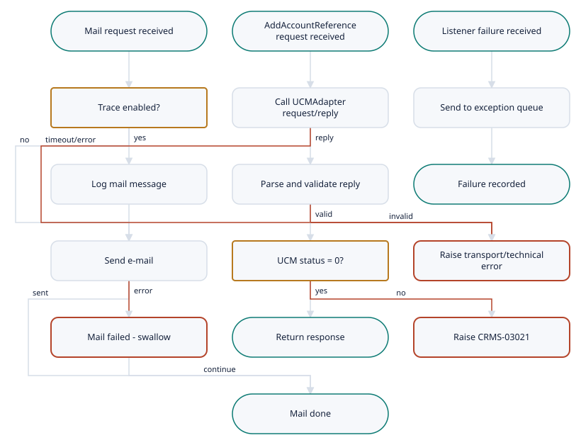

# CRMServices.SharedFramework

Demo-TIBCO-CMRService-Project · Listener · medium complexity

[← All interfaces](../../Extraction_Report.md)

- [Interface Overview](#interface-overview)
- [Interface Summary](#interface-summary)
- [Functional Analysis](#functional-analysis)
- [Technical Analysis](#technical-analysis)
- [Mappings](#mappings)
- [Business Rules](#business-rules)
- [Flow Diagram](#flow-diagram)
- [Data Model](#data-model)
- [Architecture](#architecture)

---

## Interface Overview

Provides the building blocks that every CRMServices integration relies on. These are the connection to the TIBCO EMS message bus, the e-mail notification sent when an integration fails, the hand-off of failures to the enterprise exception queue, the common message-header (CMH) stamping, the call that registers an external reference against an account or contact in UCM (AddAccountReference, service 0422), and the message contract for the account-hierarchy publication. It has no trigger of its own: other interfaces call it.

| Field | Value |
| --- | --- |
| Interface | CRMServices.SharedFramework |
| Type | Listener |
| Complexity | medium |
| Components to build | 12 |
| Mapping rules | 21 |
| Business rules | 7 |

## Interface Summary

This interface collects the shared plumbing used by the four CRMServices integrations: the EMS connection, the 'something failed' e-mail, the hand-off of failures to the enterprise exception queue, the standard message header, and one reusable back-end call that tells UCM about an external reference for an account or contact.  The parts that exist in the export are small and clear. The e-mail sub-process sends a subject and body to a configured list and never lets a mail failure stop the business flow. The AddAccountReference sub-process sends one request, checks the returned status, and raises a 'back-end replied with error' (CRMS-03021) when the status is not zero.  Much of what this interface replaces lives in a shared TIBCO library (Common\_2.2.2.projlib) that was not included in the export. That library holds the transport that actually reaches UCM, the exception-queue handler, the header schemas, the JMS connection definition and some custom Java helper functions. The mail server settings were also not exported. Until those are supplied, and the transport question for reaching UCM is decided, the profiles, connection and error handler cannot be finished.

**Complexity:** medium (score 45)

## Functional Analysis

1. **Receive mail request** — Sub-process start with MessageId, Body and Subject (all strings).
2. **Optional trace of mail** — If eai:isTraceOn('CRMS-04020') is true, log 'Sending Mail' with MessageId and Body via Common Sub\_Trace.
3. **Send e-mail** — Mail activity to host %%CRMServices/Mail/Host%%. From/To/CC/BCC come from global variables; subject is the input; body is tib:render-xml(Body).
4. **Optional trace of notification** — If eai:isTraceOn('CRMS-04021') is true, log 'Error Mail Send'.
5. **Mail failure** — On error, raise an Error fault with the SendFailedException msg/msgCode. All callers route this fault to a Null activity and continue.
6. **Receive AddAccountReference request** — Sub-process start with AddAccountReferenceRequest (CMH incl. TO/@DESTINATION, BODY/SIEBEL\_ACCOUNT\_ID, EXTENAL\_REFERENCE).
7. **Request/reply to UCMAdapter** — Call Common Sub\_Requester with Destination = CMH/TO/@DESTINATION, Timeout = CRMServices/RV/Timeout (5000 ms), Body = the request.
8. **Parse and validate reply** — Parse XML (validateOutput = true) as AddAccountReferenceResponse.
9. **Check UCM status** — If STATUS\_RESULT/@STATUS != 0, raise Errors/Error with MsgCode CRMS-03021, Params = ERROR\_DESCRIPTION, MsgId = MESSAGE\_ID, ApplicationError = STATUS\_RESULT. Otherwise return the response.
10. **Technical failure** — Requester error: re-raise its Errors/Error unchanged. Parse or other error: raise CRMS-03000 with the BW ErrorReport message.
11. **Hand failure to exception framework** — JMS listeners pass ComponentId, ComponentVersion, Errors, the original text body and JMS headers and properties to Common Sub\_ThrowException, then acknowledge the message.

## Technical Analysis

| Direction | Protocol | Address | Authentication |
| --- | --- | --- | --- |
| outbound | TIBCO Rendezvous request/reply (via Common Sub\_Requester) | %%Env%%.FIXED.CRM.UCMAdapter.Request.AddAccountReference.1 (subject supplied by caller in CMH/TO/@DESTINATION) | none visible (network and subject segregation) |
| outbound | SMTP | %%CRMServices/Mail/Host%% (value not in export) | unknown |
| outbound | JMS (TIBCO EMS) | %%Env%%.%%Common/ErrorHandling/ExceptionQueue%% (name not in export) | username/password (EMS) |

## Mappings

| Rule ID | Mapping | Target field | Source | Type | Condition | Function | Complexity | Notes |
| --- | --- | --- | --- | --- | --- | --- | --- | --- |
| MR-001 | AddAccountReference request to requester envelope | RequesterIn/Destination | AddAccountReferenceRequest/CMH/TO/@DESTINATION | transformed | — | direct copy | low | Callers set it to concat(Env,'.FIXED.CRM.UCMAdapter.Request.AddAccountReference.1'). In Boomi it becomes the operation destination or a dynamic document property. |
| MR-002 | AddAccountReference request to requester envelope | RequesterIn/Timeout | global variable CRMServices/RV/Timeout | hardcoded | — | 5000 | low | Operation timeout in ms. |
| MR-003 | AddAccountReference request to requester envelope | RequesterIn/Body | AddAccountReferenceRequest (whole document) | passthrough | — | xsl:copy-of | low | The request is sent unchanged. |
| MR-004 | UCM status error to KPN Errors | Errors/Error/MsgCode | constant | hardcoded | STATUS\_RESULT/@STATUS != 0 | 'CRMS-03021' | low | Catalogue text 'Backend replied with error: %1'. |
| MR-005 | UCM status error to KPN Errors | Errors/Error/Params | STATUS\_RESULT/@ERROR\_DESCRIPTION | conditional | attribute present | — | low | — |
| MR-006 | UCM status error to KPN Errors | Errors/Error/MsgId | AddAccountReferenceResponse/CMH/TRACKING/MESSAGE\_ID | conditional | element present | — | low | — |
| MR-007 | UCM status error to KPN Errors | Errors/Error/ApplicationError | STATUS\_RESULT (all attributes and children) | passthrough | — | xsl:copy-of | low | Callers read ApplicationError/@ERROR\_CODE (for example '10000' for timeout-class retry). |
| MR-008 | UCM status error to KPN Errors | fault message / messageCode | STATUS\_RESULT/@ERROR\_DESCRIPTION, @ERROR\_CODE | conditional | attribute present | — | low | In Boomi, put both in the Exception shape message in a parseable form (for example 'CRMS-03021\|\<ERROR\_CODE\>\|\<description\>'). |
| MR-009 | Technical error to KPN Errors | Errors/Error | $\_error\_Call-Process/Error | conditional | the requester call failed | copy unchanged | low | Preserves EAI-03004 (timeout). |
| MR-010 | Technical error to KPN Errors | Errors/Error/MsgCode | constant | conditional | any other error | 'CRMS-03000' | low | — |
| MR-011 | Technical error to KPN Errors | Errors/Error/Params | $\_error/ErrorReport/Msg | conditional | any other error | — | low | Boomi: Try/Catch base error message. |
| MR-012 | Mail request to mail message | from | global variable CRMServices/Mail/From | hardcoded | — | — | low | Value not in export. Cross Reference Table in Boomi. |
| MR-013 | Mail request to mail message | to, cc, bcc | global variables CRMServices/Mail/To, CC, BCC | hardcoded | — | — | low | Values not in export. |
| MR-014 | Mail request to mail message | subject | ServiceIn/Subject | transformed | — | direct copy | low | Caller-supplied, for example 'Error in GetAccountData'. |
| MR-015 | Mail request to mail message | bodyText | ServiceIn/Body | transformed | — | tib:render-xml(Body, false(), true()) | low | Plain text. |
| MR-016 | CMH header stamping (shared function) | CMH/FROM/@COMPONENT\_ID | CRMServices/ComponentId | hardcoded | — | 'CRMServices' | low | — |
| MR-017 | CMH header stamping (shared function) | CMH/FROM/@COMPONENT\_VERSION | CRMServices/ComponentVersion | hardcoded | — | '2.0.3' | low | — |
| MR-018 | CMH header stamping (shared function) | CMH/TRACKING/ITEM(new)/@APPINFO | ComponentDomain, ComponentId | calculated | — | concat(ComponentDomain,'/',ComponentId) = 'Operations/CRMServices' | low | The UpsertContact flow appends '/' + ComponentVersion; make the function take an optional version. |
| MR-019 | CMH header stamping (shared function) | CMH/TRACKING/ITEM(new)/@TIMESTAMP | current time | calculated | — | tib:timestamp() -\> Boomi current date/time | medium | The exact output format of tib:timestamp() must be matched; it is not determinable from the export. |
| MR-020 | CMH header stamping (shared function) | CMH/TRACKING/MESSAGE\_ID | inbound CMH/TRACKING/MESSAGE\_ID or eai:getMessageId(raw text) | transformed | — | custom Java -\> profile element read | medium | Java behaviour on malformed input unknown. |
| MR-021 | CMH header stamping (shared function) | CMH/TRACKING/ITEM (existing) | inbound CMH/TRACKING/ITEM | looped | — | copy all, then append the new ITEM | low | — |

_The same rows are in `Mappings.csv`, which opens in Excel._

## Business Rules

| ID | Rule | Logic | Priority |
| --- | --- | --- | --- |
| BR-001 | Non-zero UCM status is a back-end error | If AddAccountReferenceResponse/STATUS\_RESULT/@STATUS != 0, raise CRMS-03021 with UCM's ERROR\_CODE and ERROR\_DESCRIPTION; otherwise return the response. | High |
| BR-002 | Preserve transport error codes | Requester errors (including timeout EAI-03004) are passed to the caller unchanged so that callers can decide to retry. | High |
| BR-003 | Reply must be schema-valid | The UCM reply is parsed with validation; an invalid reply raises CRMS-03000. | Medium |
| BR-004 | Mail failure never affects the business outcome | Send Mail raises an error on SendFailedException, but every caller catches it with a Null activity and continues its own error path. | High |
| BR-005 | Trace switch per message code | Mail sending (CRMS-04020) and mail notification (CRMS-04021) are logged only when eai:isTraceOn(code) is true. | Low |
| BR-006 | Message catalogue | Error codes and texts: CRMS-03000 Technical Error; 03001 Account Hierarchy exceeds 50 accounts; 03002 Error Parsing response; 03003 Error parsing request; 03004 Called service returned error %1; 03011 Output data invalid; 03020 General Un-attributable Error; 03021 Backend replied with error: %1; 03022 No SiebelAccount found in received message; 04020 Sending Mail; 04021 Mail Notification. Application code CRMS, locale en\_UK. | Medium |
| BR-007 | Failed listener messages go to the exception framework and are acknowledged | On an unhandled error, a JMS listener passes Errors (or EAI-03057), the text body and JMS headers to Common Sub\_ThrowException, then confirms the message. | High |

## Flow Diagram

1. **Mail request received** — Sub: CRM Send Error Mail. Inputs MessageId, Body, Subject.
2. **AddAccountReference request received** — Sub: UCM AccountReference ADD. CMH/TO/@DESTINATION already set by the caller.
3. **Listener failure received** — Sub: CRM Error Handler, called from listener Catch paths.
4. **Trace enabled?** — eai:isTraceOn('CRMS-04020') in BW; process property in Boomi.
5. **Call UCMAdapter request/reply** — Timeout 5000 ms. BW: Common Sub\_Requester over Rendezvous.
6. **Send to exception queue** — EMS queue %%Env%%.%%Common/ErrorHandling/ExceptionQueue%% (name and format not in export).
7. **Log mail message** — Common Sub\_Trace with CRMS-04020.
8. **Parse and validate reply** — AddAccountReferenceResponse, validateOutput = true.
9. **Failure recorded** — Caller then acknowledges the JMS message.
10. **Send e-mail** — Mail connector; recipients from CRT.
11. **UCM status = 0?** — STATUS\_RESULT/@STATUS.
12. **Raise transport/technical error** — Requester error passed through unchanged (EAI-03004 on timeout); otherwise CRMS-03000.
13. **Mail failed - swallow** — BW raises Error; all callers ignore it. In Boomi, Try/Catch inside the sub-process.
14. **Return response**
15. **Raise CRMS-03021** — ApplicationError = STATUS\_RESULT, Params = ERROR\_DESCRIPTION.
16. **Mail done**

## Data Model

| Profile | Format | Component |
| --- | --- | --- |
| UCM AccountReference ADD Req XML Prof | xml | shared-ucm-accountreference-add-req-prof |
| UCM AccountReference ADD Resp XML Prof | xml | shared-ucm-accountreference-add-resp-prof |
| CRM UpsertAccountWithReferencing PUBLISH XML Prof | xml | shared-crm-uawr-publish-prof |

## Architecture

**How the legacy pieces map to Boomi**

| Legacy | Boomi |
| --- | --- |
| Send Mail.process (MailPubActivity) | shared-sub-send-error-mail + shared-mail-send-op + shared-smtp-mail-conn |
| Sub\_AddAccountReference.process | shared-sub-ucm-accountreference-add + shared-ucm-accountreference-add-op |
| Common Sub\_Requester (RV request/reply) | JMS request/reply operation on shared-ems-jms-conn (assumed) |
| Common Sub\_ThrowException / Sub\_ErrorTrace | shared-sub-error-handler + shared-exception-queue-send-op |
| Common Sub\_Trace + eai:isTraceOn | Process property trace flag; Notify shapes, or omitted |
| /Common/Shared Resources/JMS Connection.sharedjmscon + Common/JMS substvar | shared-ems-jms-conn with Environment Extensions |
| eai:getMessageId and CMH stamping in every mapper | shared-cmh-header-fn (user-defined map function) |
| CRMServicesMessages.xml / EAIMessages.xml | Cross Reference Table 'CRM Message Catalogue CRT' |
| UpsertAccountWithReferencing.xsd (+ Imported 0420) | shared-crm-uawr-publish-prof |
| CRMServices/Mail/\* global variables | Mail connection extension + 'CRM Mail Distribution CRT' |

**Components**

| Component | Role |
| --- | --- |
| shared-ems-jms-conn | EMS connection for all JMS listen/send/request-reply operations |
| shared-smtp-mail-conn | SMTP connection for error notifications |
| shared-mail-send-op | Send plain-text mail |
| shared-exception-queue-send-op | Send failure records to the EAI exception queue |
| shared-cmh-header-fn | Stamp CMH FROM/TRACKING fields |
| shared-sub-send-error-mail | Error notification sub-process |
| shared-sub-error-handler | Exception framework sub-process |
| shared-ucm-accountreference-add-req-prof | AddAccountReference request profile |
| shared-ucm-accountreference-add-resp-prof | AddAccountReference response profile |
| shared-ucm-accountreference-add-op | UCM AddAccountReference request/reply operation |
| shared-sub-ucm-accountreference-add | Reusable AddAccountReference sub-process |
| shared-crm-uawr-publish-prof | Hierarchy publication contract between GetAccountData and UpsertAccountWithReferences |

## Client questions

- **Q-001** Can you provide the KPN EAI Common library (Common\_2.2.2.projlib), including Base.xsd, ResultStatus.xsd, Errors.xsd, EAIMessages.xml and the source of the CommonXPathFunctions Java class?
  **If this is not answered:** Header, status and error structures are reconstructed from how the CRMServices mappings use them; they are validated against real messages captured from the current system before go-live.
- **Q-002** How should the migrated integrations reach UCMAdapter for AddAccountReference, now that TIBCO Rendezvous will not be available to Boomi?
  **If this is not answered:** EMS (JMS) request/reply to the same subject name, with an RV-to-EMS bridge or the adapter re-pointed to EMS by the client's middleware team.
- **Q-003** Which mail server should the migrated error notifications use, and who should receive them (To, CC, BCC) in each environment?
  **If this is not answered:** Notifications are built against a placeholder SMTP connection and an empty distribution table that must be filled in before testing.
- **Q-004** Should error e-mails keep including the full failing message, which contains contact personal data, or only the message ID, error code and description?
  **If this is not answered:** Mails carry the service name, message ID, error code and error description only; the full message stays in the exception queue and in Boomi process reporting.
- **Q-005** What is the name and expected message format of the enterprise exception queue that failed CRMServices messages are sent to, and which team or tool reads it?
  **If this is not answered:** Failures are sent to a queue named from the environment prefix plus a configurable name, in a simple XML record holding the error codes, message ID, original body and JMS properties. Downstream tooling may need adjusting.
- **Q-006** Does any system or support process depend on the specific CRMServices and EAI error codes (for example CRMS-03021 'Backend replied with error' or EAI-03004 for a timeout)?
  **If this is not answered:** The existing CRMS codes are kept, and a Boomi timeout is reported as EAI-03004 so that retry rules behave as today. BWENGINE codes are not reproduced.
- **Q-007** Do any systems that read CRMServices messages rely on the exact format of the tracking timestamp or the 'Operations/CRMServices' application tag in the message header?
  **If this is not answered:** ISO 8601 date-time with milliseconds and time-zone offset is used, and the application tag is kept as 'Operations/CRMServices'.
- **Q-008** Which EMS server addresses, and which dedicated service account, should the Boomi runtime use in each environment (development, test, production)?
  **If this is not answered:** The connection is built with environment extensions left empty, to be filled in by the client's EMS administrators at deployment.
- **Q-009** Should traffic between Boomi and EMS be encrypted (SSL/TLS)?
  **If this is not answered:** The same transport as today's production configuration is used once the EMS administrators confirm it; otherwise SSL is recommended.
- **Q-010** Roughly how many failures, and how many new account or contact references, do the CRMServices integrations handle per day, and what is the busiest hour?
  **If this is not answered:** Low volume (thousands per day or fewer), served by a single Boomi runtime with the same concurrency as today (10 sessions per listener).
