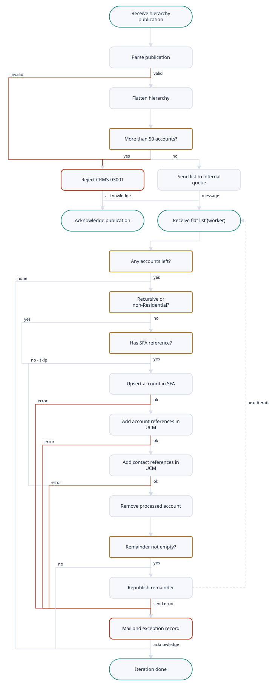

# CRMServices.UpsertAccountWithReferences (1056)

Demo-TIBCO-CMRService-Project · Listener · complex complexity

[← All interfaces](../../Extraction_Report.md)

- [Interface Overview](#interface-overview)
- [Interface Summary](#interface-summary)
- [Functional Analysis](#functional-analysis)
- [Technical Analysis](#technical-analysis)
- [Mappings](#mappings)
- [Business Rules](#business-rules)
- [Flow Diagram](#flow-diagram)
- [Data Model](#data-model)
- [Architecture](#architecture)

---

## Interface Overview

Consumes an account-hierarchy publication (KPN EAI service 1056, contract 0420 'UpsertAccountWithReferencing') and writes every account of the hierarchy to SFA, one account at a time (SFAAdapter UpsertAccount, contract 0421). For each account and contact that SFA reports as newly created, it registers the external references in UCM (AddAccountReference 0422, via crm-shared-framework). Hierarchies of more than 50 accounts are rejected. Accounts are processed sequentially by republishing the remaining list to a private queue after each account.

| Field | Value |
| --- | --- |
| Interface | CRMServices.UpsertAccountWithReferences (1056) |
| Type | Listener |
| Complexity | complex |
| Components to build | 15 |
| Mapping rules | 33 |
| Business rules | 7 |

## Interface Summary

This interface takes a customer's account hierarchy, published by GetAccountData, and writes it into SFA. It flattens the tree into a list, refuses anything over 50 accounts, and then handles the accounts strictly one at a time. For each account it calls SFA's 'upsert account'. For every account and contact that SFA reports as newly created, it asks UCM to record the external reference, so that both systems know the same customer by the same identifiers.  The one-at-a-time processing is done in an unusual way. After each account, the remaining list is put back on a private message queue and picked up again. That makes each account its own unit of work, but if one account fails, all accounts after it in that hierarchy are abandoned. The failing list is sent to integration support by e-mail and to the exception queue. There is no rollback: an account already written to SFA stays written, even if its UCM references fail.  This is the most complex interface in the project. It combines a tree-flattening step that needs a script, a choice about whether to keep the private-queue iteration in Boomi, a filtering rule for residential accounts, nested loops over accounts and contacts, and writes to two systems with no compensation. It also shares the project-wide blockers: Rendezvous transport to the adapters, missing header schemas, and the missing exception handler.

**Complexity:** complex (score 85)

## Functional Analysis

1. **Receive publication** — JMS Queue Receiver on %%Env%%.FIXED.Operations.%%CRMServices/ComponentId%%.Subscribe.UpsertAccountWithReferences.1; Text; CLIENT\_ACKNOWLEDGE; non-transacted; max sessions JmsMaxSessions.
2. **Trace (optional)** — If eai:isTraceOn('EAI-04052') is true, log destination, headers and body via Common Sub\_Trace.
3. **Parse publication** — Parse Body as UpsertAccountWithReferencingPublish.
4. **Flatten hierarchy** — Mapper FlattenAccountHierarchy: CMH rebuilt (ID 1056, NAME '\_UpsertAccountWithReferences', MID 1056.20, PUBLISH, OBJECT FLAT\_SIEBEL\_ACCOUNT\_HIERARCHY, TO = internal queue); RecursiveProcessing copied if present; one SiebelAccount per BODY//SiebelAccount.
5. **Check size limit** — If count(FlatAccountHierarchy/SiebelAccount) \> 50, raise Errors CRMS-03001 (MsgId = MESSAGE\_ID).
6. **Hand off to internal queue** — Common Sub\_NotifierJMS sends the rendered FlatAccountHierarchy to %%Env%%.FIXED.Operations.CRMServices.\_UpsertAccountWithReferences.1.
7. **Acknowledge publication** — Confirm the JMS message on success, and also after an error has been passed to Common Sub\_ThrowException.
8. **Receive flat list (worker)** — JMS Queue Receiver on the internal queue (same settings), then parse as FlatAccountHierarchy.
9. **Empty list?** — If count(SiebelAccount) = 0, trace CRMS-03022 'No SiebelAccount found in received message' with the message, and end.
10. **Apply Residential filter** — sendAccountThrough = if RecursiveProcessing = 'true' then true else not(SiebelAccount\[1\]/Type = 'Residential'). If false, process only when SiebelAccount\[1\] has CifAccountReference\[SystemName = 'SFA'\] (loop over \[1\], so at most once).
11. **Upsert account into SFA** — Build UpserAccountRequest from SiebelAccount\[1\] and call SFAAdapter UpsertAccount (timeout 5000 ms); STATUS\_RESULT/@STATUS != 0 raises CRMS-03021.
12. **Register account references** — For each SFA response SiebelAccount\[OCRMOperation = 'Create'\]/CifAccountReference, call UCM AddAccountReference (IntObjectName UCMAccountExternalID).
13. **Register contact references** — For each response Contact, then each CifContactReference of a Contact with OCRMOperation = 'Create', call UCM AddAccountReference (IntObjectName UCMContactExternalID).
14. **Remove processed account** — Copy SiebelAccount\[position() \> 1\] into a new FlatAccountHierarchy, with TRACKING from the last successful back-end call (EVENT '\_UpsertAccountWithReferencing').
15. **Republish remainder** — If count \> 0, send the remainder to $Start CMH/TO/@DESTINATION (the same internal queue), which repeats steps 8 to 15.
16. **Worker error path** — Mail 'Error in UpserAccountWithReferencing' with all Error Params and the rendered remaining list, then Throw Exception, then Common Sub\_ThrowException, then acknowledge.

## Technical Analysis

| Direction | Protocol | Address | Authentication |
| --- | --- | --- | --- |
| inbound | JMS queue (TIBCO EMS) | %%Env%%.FIXED.Operations.%%CRMServices/ComponentId%%.Subscribe.UpsertAccountWithReferences.1 | EMS username/password (shared connection) |
| inbound | JMS queue (TIBCO EMS, private) | %%Env%%.FIXED.Operations.%%CRMServices/ComponentId%%.\_UpsertAccountWithReferences.1 | EMS username/password |
| outbound | JMS queue send via Common Sub\_NotifierJMS | concat(Env,'.FIXED.Operations.',ComponentId,'.\_UpsertAccountWithReferences.1') | EMS username/password |
| outbound | Rendezvous request/reply via Common Sub\_Requester | concat(Env,'.FIXED.CRM.SFAAdapter.Request.UpsertAccount.1') | none visible |
| outbound | Rendezvous request/reply (via crm-shared-framework) | concat(Env,'.FIXED.CRM.UCMAdapter.Request.AddAccountReference.1') | none visible |

## Mappings

| Rule ID | Mapping | Target field | Source | Type | Condition | Function | Complexity | Notes |
| --- | --- | --- | --- | --- | --- | --- | --- | --- |
| MR-001 | Flatten hierarchy publication | CMH/ID, NAME, MID, PARADIGM, OBJECT, VERSION | constants | hardcoded | — | '1056', '\_UpsertAccountWithReferences', '1056.20', 'PUBLISH', 'FLAT\_SIEBEL\_ACCOUNT\_HIERARCHY', '1.0' | low | — |
| MR-002 | Flatten hierarchy publication | CMH/TO/@DESTINATION | Env, ComponentId | calculated | — | concat(Env,'.FIXED.Operations.',ComponentId,'.\_UpsertAccountWithReferences.1') | low | The worker republishes to this value, so it acts as the iteration address. |
| MR-003 | Flatten hierarchy publication | CMH/TRACKING | publication CMH/TRACKING | transformed | EXTERNAL\_REF if present | MESSAGE\_ID, EXTERNAL\_REF, ITEMs copied + new ITEM (APPINFO 'Operations/CRMServices', EVENT '\_UpsertAccountWithReferencing') | low | — |
| MR-004 | Flatten hierarchy publication | RecursiveProcessing | BODY/RecursiveProcessing | conditional | present | copy | low | — |
| MR-005 | Flatten hierarchy publication | SiebelAccount (one per source account) | BODY//SiebelAccount | looped | all depths, document order | descendant-axis for-each | high | Groovy in Boomi. Children are not nested in the output (Type\_SiebelAccount). |
| MR-006 | Flatten hierarchy publication | SiebelAccount/{AccountHierarchyLevel ... UUID, OCRMOperation} | same-named elements | conditional | each copied if present | — | low | Includes OCRMOperation and DisableMailings, MasterAccountIntegrationId (presence-checked here). |
| MR-007 | Flatten hierarchy publication | SiebelAccount/{Account\_Affiliation, Contact (incl. OCRMOperation), BusinessAddress (@IsPrimaryMVG), CifAccountReference (AccountId, CIFSystemId, ExternalId1, SystemName, SystemNumber)} | same-named children | looped | fields copied if present | for-each | medium | — |
| MR-008 | Current account to SFA UpsertAccount request | CMH/ID, NAME, MID, PARADIGM, OBJECT, VERSION | constants | hardcoded | — | '1056', 'UpsertAccount', '1056.20', 'REQUEST', 'SIEBEL\_ACCOUNT', '1.0' | low | Both call variants (filtered and unfiltered) use identical bindings. |
| MR-009 | Current account to SFA UpsertAccount request | CMH/TO/@DESTINATION | Env | calculated | — | concat(Env,'.FIXED.CRM.SFAAdapter.Request.UpsertAccount.1') | low | — |
| MR-010 | Current account to SFA UpsertAccount request | CMH/TRACKING | FlatAccountHierarchy/CMH/TRACKING | transformed | — | MESSAGE\_ID, EXTERNAL\_REF, ITEMs + new ITEM (APPINFO 'Operations/CRMServices', EVENT 'UpsertAccount') | low | — |
| MR-011 | Current account to SFA UpsertAccount request | BODY/SiebelAccount (scalar fields incl. OCRMOperation) | FlatAccountHierarchy/SiebelAccount\[1\] | conditional | fields copied if present | — | low | Only the first account of the list. |
| MR-012 | Current account to SFA UpsertAccount request | BODY/SiebelAccount/{Account\_Affiliation, Contact (incl. OCRMOperation), BusinessAddress} | SiebelAccount\[1\] children | looped | fields copied if present | for-each | medium | — |
| MR-013 | Current account to SFA UpsertAccount request | BODY/SiebelAccount/CifAccountReference | none | hardcoded | — | not mapped | low | The request schema allows it, but the source does not send it; SFA returns references in its response. |
| MR-014 | SFA response to UCM AddAccountReference (account) | (iteration) | UpserAccountResponse/BODY/SiebelAccount\[OCRMOperation='Create'\]/CifAccountReference | looped | account created by SFA | one request per reference | medium | — |
| MR-015 | SFA response to UCM AddAccountReference (account) | CMH/ID, NAME, MID, PARADIGM, OBJECT | constants | hardcoded | — | '1056', 'AddAccountReference', '1056.20', 'REQUEST', 'SIEBEL\_ACCOUNT\_ID' | low | — |
| MR-016 | SFA response to UCM AddAccountReference (account) | CMH/FID | SiebelAccount/UUID | conditional | present | — | low | — |
| MR-017 | SFA response to UCM AddAccountReference (account) | CMH/TO/@DESTINATION | Env | calculated | — | concat(Env,'.FIXED.CRM.UCMAdapter.Request.AddAccountReference.1') | low | UCMAdapter hard-coded (not the UCMAdapter/ComponentID variable). |
| MR-018 | SFA response to UCM AddAccountReference (account) | CMH/ATTRIBUTE IntObjectName | constant | hardcoded | — | 'UCMAccountExternalID' | low | — |
| MR-019 | SFA response to UCM AddAccountReference (account) | BODY/SIEBEL\_ACCOUNT\_ID | SiebelAccount/UUID | transformed | — | copy | low | — |
| MR-020 | SFA response to UCM AddAccountReference (account) | BODY/EXTENAL\_REFERENCE/{REFERENCE, ORIGIN, ORIGIN\_ID} | CifAccountReference/{ExternalId1, SystemName, SystemNumber} | transformed | — | copy | low | — |
| MR-021 | SFA response to UCM AddAccountReference (contact) | (iteration) | BODY/SiebelAccount/Contact, then Contact\[OCRMOperation='Create'\]/CifContactReference | looped | contact created by SFA | nested loop; one request per contact reference | medium | — |
| MR-022 | SFA response to UCM AddAccountReference (contact) | CMH/FID | Contact/UUID | transformed | — | copy (always written) | low | — |
| MR-023 | SFA response to UCM AddAccountReference (contact) | CMH/TRACKING | previous AddAccountReference response TRACKING, else start TRACKING | conditional | an account-reference response exists | copy + new ITEM EVENT 'AddAccountReference' | low | — |
| MR-024 | SFA response to UCM AddAccountReference (contact) | CMH/ATTRIBUTE IntObjectName | constant | hardcoded | — | 'UCMContactExternalID' | low | — |
| MR-025 | SFA response to UCM AddAccountReference (contact) | BODY/SIEBEL\_ACCOUNT\_ID | Contact/UUID | conditional | present | copy | low | The contact's UUID, not the account's. |
| MR-026 | SFA response to UCM AddAccountReference (contact) | BODY/EXTENAL\_REFERENCE/{REFERENCE, ORIGIN, ORIGIN\_ID} | CifContactReference/{ExternalId1, SystemName, SystemNumber} | transformed | — | copy | low | — |
| MR-027 | Remaining accounts (iteration) | CMH/{ID, NAME, FID, MID, PARADIGM, OBJECT, VERSION, FROM, TO} | input FlatAccountHierarchy CMH | passthrough | FID and MID if present | copy | low | — |
| MR-028 | Remaining accounts (iteration) | CMH/TRACKING | Tracking returned by the SFA/UCM sub-process (filtered or unfiltered call) | conditional | whichever call ran | MESSAGE\_ID, EXTERNAL\_REF, ITEMs + new ITEM EVENT '\_UpsertAccountWithReferencing' | medium | xsl:choose with two branches and no otherwise: if the account was skipped by the filter, no TRACKING element is written, so MESSAGE\_ID is lost for the rest of the hierarchy (and the republish MessageId is empty). If Base.xsd makes TRACKING mandatory, the next iteration fails to parse. |
| MR-029 | Remaining accounts (iteration) | RecursiveProcessing | input RecursiveProcessing | conditional | present | copy | low | — |
| MR-030 | Remaining accounts (iteration) | SiebelAccount | SiebelAccount\[position() \> 1\] | looped | — | full field copy incl. children and CifAccountReference | medium | — |
| MR-031 | Worker error mail | Subject | constant | hardcoded | — | 'Error in UpserAccountWithReferencing' | low | Misspelling as in source. |
| MR-032 | Worker error mail | Body | Errors/Error/Params, FlatAccountHierarchy | calculated | — | concat('Location :UpserAccountWithReferences', tib:concat-sequence-format(Params, newline), 'Message Causing Error is : ', render-xml(FlatAccountHierarchy)) | low | The message rendered is the list received by the failing iteration (failed account plus remaining). |
| MR-033 | Worker error mail | MessageId | FlatAccountHierarchy/CMH/TRACKING/MESSAGE\_ID | transformed | — | copy | low | — |

_The same rows are in `Mappings.csv`, which opens in Excel._

## Business Rules

| ID | Rule | Logic | Priority |
| --- | --- | --- | --- |
| BR-001 | Maximum 50 accounts per hierarchy | After flattening, if count(SiebelAccount) \> 50, reject the whole publication with CRMS-03001 'Account Hierarchy exceeds 50 accounts'. | High |
| BR-002 | Residential account filter | sendAccountThrough = if RecursiveProcessing = 'true' then true else not(SiebelAccount\[1\]/Type = 'Residential'). If false, send only if SiebelAccount\[1\]/CifAccountReference\[SystemName = 'SFA'\] exists. Otherwise skip the account and continue. | High |
| BR-003 | Sequential per-account processing | Process SiebelAccount\[1\], remove it, republish the remainder to the internal queue while count \> 0; parents before children. | High |
| BR-004 | References only for created records | UCM AddAccountReference is called only for SFA response accounts and contacts with OCRMOperation = 'Create' (case-sensitive), once per CifAccountReference or CifContactReference. | High |
| BR-005 | SFA non-zero status is an error | UpserAccountResponse/STATUS\_RESULT/@STATUS != 0 raises CRMS-03021 with ERROR\_DESCRIPTION. | High |
| BR-006 | Stop hierarchy on first failure | Any failure in an iteration stops further accounts; the failing list is mailed and passed to the exception framework; the message is acknowledged. | High |
| BR-007 | Ignore empty publications | A flat list with no SiebelAccount is traced as CRMS-03022 and ignored. | Low |

## Flow Diagram

1. **Receive hierarchy publication** — Queue ...Subscribe.UpsertAccountWithReferences.1 (uawr-subscribe-listen-op).
2. **Parse publication** — UpsertAccountWithReferencingPublish.
3. **Flatten hierarchy** — uawr-flatten-fn; descendant order.
4. **More than 50 accounts?**
5. **Reject CRMS-03001** — Exception framework; acknowledge; no mail.
6. **Send list to internal queue** — uawr-internal-send-op.
7. **Acknowledge publication**
8. **Receive flat list (worker)** — uawr-internal-listen-op.
9. **Any accounts left?** — count(SiebelAccount) \> 0; else trace CRMS-03022.
10. **Recursive or non-Residential?** — RecursiveProcessing = 'true' or Type != 'Residential'.
11. **Has SFA reference?** — CifAccountReference\[SystemName = 'SFA'\].
12. **Upsert account in SFA** — uawr-sfa-upsertaccount-op; STATUS != 0 is an error.
13. **Add account references in UCM** — Created accounts only; Sub: UCM AccountReference ADD.
14. **Add contact references in UCM** — Created contacts only.
15. **Remove processed account** — uawr-remaining-accounts-map.
16. **Remainder not empty?**
17. **Republish remainder** — Back to the internal queue.
18. **Mail and exception record** — 'Error in UpserAccountWithReferencing' + Sub: CRM Error Handler; remaining accounts abandoned.
19. **Iteration done** — Acknowledge.

## Data Model

| Profile | Format | Component |
| --- | --- | --- |
| CRM FlatAccountHierarchy PUBLISH XML Prof | xml | uawr-flat-hierarchy-prof |
| SFA Account UPSERT Req XML Prof | xml | uawr-sfa-upsertaccount-req-prof |
| SFA Account UPSERT Resp XML Prof | xml | uawr-sfa-upsertaccount-resp-prof |

## Architecture

**How the legacy pieces map to Boomi**

| Legacy | Boomi |
| --- | --- |
| Subscribe\_UpsertAccountWithReferencesJMS | uawr-subscribe-listen-op + uawr-main-process |
| FlattenAccountHierarchy mapper | uawr-flatten-fn (Groovy) |
| count \> 50 transition + Generate Error | Decision + Exception |
| Sub\_NotifierJMS to internal queue | uawr-internal-send-op |
| \_Subscribe\_UpsertAccountWithReferencesJMS | uawr-internal-listen-op + uawr-worker-process |
| SetFilter assign + transitions + Group over SFA reference | Decision shapes |
| CallUpsertAccountIntoSFAUCM input mapping | uawr-flat-to-sfa-map |
| \_Sub\_UpsertAccountIntoSFA\_UCM | uawr-sub-upsert-into-sfa-ucm |
| Sub\_UpsertAccount | uawr-sfa-upsertaccount-op + Decision on STATUS |
| AddAccountReference inputLoop groups | Data Process split + uawr-sfa-to-ucm-accountref-map / uawr-sfa-to-ucm-contactref-map + Process Call shared-sub-ucm-accountreference-add |
| RemoveProcessedAccount + Republish Message | uawr-remaining-accounts-map + uawr-internal-send-op, or the Flow Control loop |
| SendErrorMail + Throw + Sub\_ThrowException | Catch: shared-sub-send-error-mail + shared-sub-error-handler |

**Components**

| Component | Role |
| --- | --- |
| uawr-subscribe-listen-op | Listener on the Subscribe queue |
| uawr-flat-hierarchy-prof | Flat account list profile |
| uawr-flatten-fn | Hierarchy flattening |
| uawr-internal-send-op | Send flat list to internal queue |
| uawr-internal-listen-op | Worker listener |
| uawr-sfa-upsertaccount-req-prof | SFA request profile |
| uawr-sfa-upsertaccount-resp-prof | SFA response profile |
| uawr-sfa-upsertaccount-op | SFA UpsertAccount request/reply |
| uawr-flat-to-sfa-map | Account to SFA request |
| uawr-sfa-to-ucm-accountref-map | Account reference request |
| uawr-sfa-to-ucm-contactref-map | Contact reference request |
| uawr-remaining-accounts-map | Remainder for next iteration |
| uawr-sub-upsert-into-sfa-ucm | Per-account SFA + UCM writes |
| uawr-worker-process | Per-account worker |
| uawr-main-process | Main listener |

## Client questions

- **Q-001** If one account in a hierarchy fails, should the migrated process be able to restart from that account, or is it acceptable to re-run the whole hierarchy?
  **If this is not answered:** In-process sequential processing in one execution; on failure, the remaining accounts (including the failed one) are sent to the exception queue and the error mail, so they can be re-driven.
- **Q-002** Is it safe to send the same account to SFA, and the same external reference to UCM, a second time when a failed hierarchy is re-processed?
  **If this is not answered:** Both operations are treated as safe to repeat, and re-drive re-sends the failed account in full.
- **Q-003** Apart from GetAccountData, which systems publish account hierarchies to this flow, and should their residential accounts still be skipped unless they already have an SFA reference?
  **If this is not answered:** The filter is kept exactly as today.
- **Q-004** Should a hierarchy with more than 50 accounts still be rejected completely, and should integration support be e-mailed when that happens?
  **If this is not answered:** The 50-account limit is kept, and rejection is recorded in the exception framework without e-mail, as today.
- **Q-005** After a residential account is skipped, should the remaining accounts keep the original message tracking ID, which today is lost from that point on?
  **If this is not answered:** The original tracking ID is kept for all accounts (fixing the defect).
- **Q-006** When a hierarchy fails, should the error e-mail still list all remaining accounts with their contacts' personal details?
  **If this is not answered:** The e-mail carries the message ID, error and failing account ID only; the full list goes to the exception queue.
- **Q-007** After a failure is recorded, should the failed publication ever be retried automatically, or only re-driven by support?
  **If this is not answered:** No automatic retry; support re-drives from the exception record.
- **Q-008** How many hierarchy publications arrive per day, and how many accounts does a typical hierarchy contain?
  **If this is not answered:** Low volume; typical hierarchies of fewer than 10 accounts.
