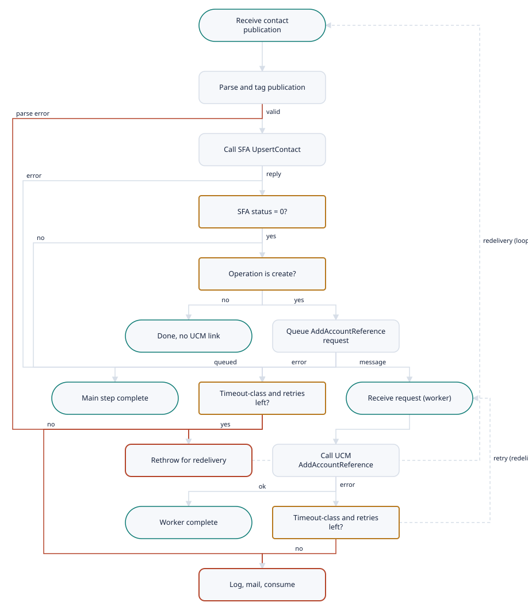

# CRMServices.UpsertContactPub (0429/1062)

Demo-TIBCO-CMRService-Project · Listener · medium complexity

[← All interfaces](../../Extraction_Report.md)

- [Interface Overview](#interface-overview)
- [Interface Summary](#interface-summary)
- [Functional Analysis](#functional-analysis)
- [Technical Analysis](#technical-analysis)
- [Mappings](#mappings)
- [Business Rules](#business-rules)
- [Flow Diagram](#flow-diagram)
- [Data Model](#data-model)
- [Architecture](#architecture)

---

## Interface Overview

Applies contact-person publications (contract 0429 'UpsertContactPub') to SFA. Each publication is sent to SFAAdapter UpsertContact (contract 0431, CRMServices service 1062). When SFA reports that it created the contact, an AddAccountReference request (0422) is queued on a private queue. A second listener sends that request to UCM so that UCM records the SFA contact ID as an external reference of the Siebel account. Only timeout-class failures are retried, through JMS redelivery, with separate limits for the two steps (4 and 5).

| Field | Value |
| --- | --- |
| Interface | CRMServices.UpsertContactPub (0429/1062) |
| Type | Listener |
| Complexity | medium |
| Components to build | 11 |
| Mapping rules | 22 |
| Business rules | 5 |

## Interface Summary

When a contact person changes in the customer master, a publication arrives and this interface applies the change to SFA. If SFA reports that it created a new contact, rather than updating an existing one, a second step tells UCM about the new SFA contact ID, so that UCM can link the two records. That second step runs separately, from its own queue, so it can be retried independently.  Retries are deliberately narrow. Only failures that look like timeouts (a transport timeout, the TIBCO engine timeout code, or a back-end error code 10000) are retried, by letting the message be redelivered: up to 4 times for the SFA step and 5 times for the UCM step. Every other failure is logged, e-mailed to integration support and dropped. If queuing the UCM step itself fails, the contact is in SFA but the UCM link is never made, and only an e-mail records it.  The flow is moderately complex. Its two listeners, two back-end calls and two maps are straightforward, apart from the large but 1:1 contact mapping. What needs care is reproducing the retry behaviour on Boomi's JMS connector: it depends on the message's redelivery count, and on a TIBCO framework component (Sub\_ThrowException) that is not in the export. The Rendezvous transport to the adapters and the missing header schemas are shared blockers.

**Complexity:** medium (score 62)

## Functional Analysis

1. **Receive publication** — JMS Queue Receiver on %%Env%%.FIXED.%%CRMServices/ComponentDomain%%.%%CRMServices/ComponentId%%.Subscribe.UpsertContactPub.1; Text; CLIENT\_ACKNOWLEDGE; max sessions JmsMaxSessions.
2. **Compute redeliver flag** — redeliver = if not(exists(OtherProperties/RedeliveryCount)) then true() else RedeliveryCount \< CRMServices/UpsertContactPub/UpsertContact\_redeliverycount (4).
3. **Parse and tag publication** — Parse as UpsertContactPub; copy the CMH (ID, NAME, FID, MID, PARADIGM, OBJECT, VERSION, FROM, TO, TRACKING, ATTRIBUTE) and add ATTRIBUTE RESEND\_ALLOWED = redeliver; copy BODY.
4. **Call SFA UpsertContact** — Build UpsertContactRequest (0431; CMH ID 1062, NAME 'UpsertContact', MID 1062.20); Common Sub\_Requester to %%Env%%.FIXED.CRM.SFAAdapter.Request.UpsertContact.1, timeout CRMServices/RV/Timeout (5000 ms).
5. **Parse SFA response** — Parse as SFA UpsertContactResponse; failure raises CRMS-03002.
6. **SFA status check** — RESULT\_STATUS/@STATUS != 0 raises Error MsgCode 'EAI-03004' with ActivityError = the SFA response.
7. **Was the contact created?** — If STATUS = 0 and lower-case(CMH/ATTRIBUTE\[@NAME='OPERATION'\]/@VALUE) != 'create', end without publishing (DoNotPublish).
8. **Build AddAccountReference request** — Mapper 'Build AddAccountReference Request' from the SFA response.
9. **Queue UCM step** — Common Sub\_NotifierJMS to concat(Env,'.FIXED.Operations.',ComponentId,'.\_UpsertContactPub.1') with the rendered request; MessageId = SFA response MESSAGE\_ID.
10. **Main error decision** — On error from the group: if (Call error MsgCode = 'EAI-03004' or ErrorReport/Msg = 'BWENGINE-100067' or SFA RESULT\_STATUS/@ERROR\_CODE = '10000') and RESEND\_ALLOWED = 'true', raise Generate Error (rethrow). Otherwise LogError (Sub\_ErrorTrace), then Send Error Mail, then end normally.
11. **Listener handling of rethrow** — Main\_UpsertContactPub throws (MsgCode from the error, else CRMS-03003 parse, else CRMS-03000; text from eai:getMessageText). The listener calls Common Sub\_ThrowException, then Confirm.
12. **Receive internal request (worker)** — JMS Queue Receiver on %%Env%%.FIXED.%%CRMServices/ComponentDomain%%.%%CRMServices/ComponentId%%.\_UpsertContactPub.1; redeliver = RedeliveryCount \< AddAccountRefernce\_redelivercount (5).
13. **Parse and call UCM** — Parse as AddAccountReferenceRequest (failure: CRMS-03003); rebuild the CMH (OBJECT 'SIEBEL\_ADCCOUNT\_ID', new ITEM EVENT 'AddAccountReferenceRequest'); call Sub\_AddAccountReference (crm-shared-framework).
14. **Worker error decision** — Code0 = first Error/ApplicationError/@ERROR\_CODE else '10001'. If (first MsgCode = 'EAI-03004' or Msg = 'BWENGINE-100067' or Code0 = '10000') and redeliver = 'true', throw; otherwise LogError, then mail 'Error in 0429-UpsertContactPub', then end normally.

## Technical Analysis

| Direction | Protocol | Address | Authentication |
| --- | --- | --- | --- |
| inbound | JMS queue (TIBCO EMS) | %%Env%%.FIXED.%%CRMServices/ComponentDomain%%.%%CRMServices/ComponentId%%.Subscribe.UpsertContactPub.1 (default XDVL.FIXED.Operations.CRMServices.Subscribe.UpsertContactPub.1) | EMS username/password (shared connection) |
| outbound | Rendezvous request/reply via Common Sub\_Requester | concat(Env,'.FIXED.CRM.SFAAdapter.Request.UpsertContact.1') | none visible |
| outbound | JMS queue send via Common Sub\_NotifierJMS | concat(Env,'.FIXED.Operations.',ComponentId,'.\_UpsertContactPub.1') | EMS username/password |
| inbound | JMS queue (TIBCO EMS, private) | %%Env%%.FIXED.%%CRMServices/ComponentDomain%%.%%CRMServices/ComponentId%%.\_UpsertContactPub.1 | EMS username/password |
| outbound | Rendezvous request/reply (via crm-shared-framework) | %%Env%%.FIXED.CRM.UCMAdapter.Request.AddAccountReference.1 (CMH/TO copied from the queued request) | none visible |

## Mappings

| Rule ID | Mapping | Target field | Source | Type | Condition | Function | Complexity | Notes |
| --- | --- | --- | --- | --- | --- | --- | --- | --- |
| MR-001 | Publication to SFA UpsertContactRequest | CMH/ID, NAME, MID, PARADIGM, OBJECT, VERSION | constants | hardcoded | — | '1062', 'UpsertContact', '1062.20', 'REQUEST', 'CONTACT\_PERSON', '1.0' | low | — |
| MR-002 | Publication to SFA UpsertContactRequest | CMH/FID | UpsertContactPub/CMH/FID | transformed | — | copy | low | — |
| MR-003 | Publication to SFA UpsertContactRequest | CMH/FROM/@COMPONENT\_ID, @COMPONENT\_VERSION | ComponentId, ComponentVersion | hardcoded | — | — | low | — |
| MR-004 | Publication to SFA UpsertContactRequest | CMH/TO/@DESTINATION | Env | calculated | — | concat(Env,'.FIXED.CRM.SFAAdapter.Request.UpsertContact.1') | low | — |
| MR-005 | Publication to SFA UpsertContactRequest | CMH/TRACKING | UpsertContactPub/CMH/TRACKING | transformed | — | MESSAGE\_ID, EXTERNAL\_REF, ITEMs copied + new ITEM (APPINFO 'Operations/CRMServices', EVENT 'UpsertContactRequest', TIMESTAMP) | low | — |
| MR-006 | Publication to SFA UpsertContactRequest | BODY/CONTACT\_PERSON (all ContactPerson\_Type fields incl. OVERRIDE\_VALIDATION, validation counts, names, DATE\_OF\_BIRTH, CONTACT\_MEDIUM/USAGE, VALIDATION\_RESULT, ADDRESS with UNFORMATTED\_ADDRESS/ADDRESS\_LINE, RUNTIME\_PARAMETERS, VALIDITY, VALIDATION\_RESULT, SIEBEL\_ACCOUNT\_REFERENCE, RUNTIME\_PARAMETERS, CROSS\_REFERENCE) | UpsertContactPub/BODY/CONTACT\_PERSON | looped | leaf fields copied if present (about 100 presence checks) | nested for-each | medium | Same ContactPerson\_Type on both sides: a near-identity map. |
| MR-007 | SFA response to AddAccountReferenceRequest | CMH/ID, NAME, MID, PARADIGM, OBJECT, VERSION | constants | hardcoded | — | '1062', 'AddAccountReference', '1062.20', 'REQUEST', 'SIEBEL\_ACCOUNT\_ID', '1.0' | low | — |
| MR-008 | SFA response to AddAccountReferenceRequest | CMH/FID | SFA UpsertContactResponse/CMH/FID | transformed | — | copy | low | — |
| MR-009 | SFA response to AddAccountReferenceRequest | CMH/TO/@DESTINATION | Env | calculated | — | concat(Env,'.FIXED.CRM.UCMAdapter.Request.AddAccountReference.1') | low | Used later by the worker as the UCM destination. |
| MR-010 | SFA response to AddAccountReferenceRequest | CMH/TRACKING | SFA response CMH/TRACKING | transformed | — | MESSAGE\_ID, EXTERNAL\_REF, ITEMs + new ITEM (APPINFO 'Operations/CRMServices', EVENT 'INTERNAL\_PUBLISH\_FOR\_AddAccountReference') | low | — |
| MR-011 | SFA response to AddAccountReferenceRequest | CMH/ATTRIBUTE (IntMessageType, IntObjectName, IntObjectFormat) | constants | hardcoded | — | 'Integration Object', 'UCMContactExternalID', 'Siebel Hierarchical' | low | — |
| MR-012 | SFA response to AddAccountReferenceRequest | BODY/SIEBEL\_ACCOUNT\_ID | CONTACT\_PERSON/SIEBEL\_ACCOUNT\_REFERENCE\[1\]/SIEBEL\_ACCOUNT\_ID | transformed | first reference only | copy | low | — |
| MR-013 | SFA response to AddAccountReferenceRequest | BODY/EXTENAL\_REFERENCE/REFERENCE | CONTACT\_PERSON/RUNTIME\_PARAMETERS/ID | transformed | — | copy | low | The SFA contact ID. |
| MR-014 | SFA response to AddAccountReferenceRequest | BODY/EXTENAL\_REFERENCE/ORIGIN, ORIGIN\_ID | constants | hardcoded | — | 'SFA', 'SFA' | low | — |
| MR-015 | Worker header rebuild | CMH/ID, NAME, FID, MID, PARADIGM, VERSION, FROM, TO | queued request CMH | passthrough | FID and MID if present | copy | low | — |
| MR-016 | Worker header rebuild | CMH/OBJECT | constant | hardcoded | — | 'SIEBEL\_ADCCOUNT\_ID' | low | Typo in source; the queued request carried 'SIEBEL\_ACCOUNT\_ID'. |
| MR-017 | Worker header rebuild | CMH/TRACKING | queued request TRACKING | transformed | EXTERNAL\_REF if present | MESSAGE\_ID, EXTERNAL\_REF, ITEMs + new ITEM (APPINFO = last ITEM's APPINFO, EVENT 'AddAccountReferenceRequest') | low | — |
| MR-018 | Worker header rebuild | CMH/ATTRIBUTE, BODY | queued request | passthrough | — | copy | low | — |
| MR-019 | Error notifications | Subject (main) | constant | hardcoded | — | 'Error in service 0429-UpsertContactPub' | low | — |
| MR-020 | Error notifications | Body (main) | SFA RESULT\_STATUS/@ERROR\_DESCRIPTION, publication | calculated | — | concat(CRLF, ERROR\_DESCRIPTION, CRLF, 'Message causing error is:', CRLF, render-xml(UpsertContactPub)) | low | ERROR\_DESCRIPTION is empty for transport errors. |
| MR-021 | Error notifications | Subject / Body (worker) | ErrorReport/Msg, queued request | calculated | — | Subject 'Error in 0429-UpsertContactPub'; Body concat(CRLF, ErrorReport/Msg, CRLF, ' Message cousing error is:', CRLF, render-xml(AddAccountReferenceRequest)) | low | Typo 'cousing' as in source. |
| MR-022 | Error notifications | Errors/Error (LogError, main) | SFA RESULT\_STATUS or requester error | conditional | SFA STATUS != 0 -\> CRMS-03004 + Params ERROR\_DESCRIPTION + RESULT\_STATUS; requester MsgCode exists -\> copy; else CRMS-03000 + ErrorReport | — | low | — |

_The same rows are in `Mappings.csv`, which opens in Excel._

## Business Rules

| ID | Rule | Logic | Priority |
| --- | --- | --- | --- |
| BR-001 | UCM reference only for creates | After SFA UpsertContact: if RESULT\_STATUS/@STATUS != 0, error. If STATUS = 0 and lower-case(CMH/ATTRIBUTE\[@NAME='OPERATION'\]/@VALUE) != 'create', stop. Otherwise queue AddAccountReference. | High |
| BR-002 | Timeout-only retry, SFA step | Retry (rethrow) if (requester MsgCode = 'EAI-03004' or ErrorReport/Msg = 'BWENGINE-100067' or SFA ERROR\_CODE = '10000') and RESEND\_ALLOWED = 'true'; RESEND\_ALLOWED = (no RedeliveryCount) or RedeliveryCount \< 4. | High |
| BR-003 | Timeout-only retry, UCM step | Retry if (first MsgCode = 'EAI-03004' or Msg = 'BWENGINE-100067' or first ApplicationError/@ERROR\_CODE (default '10001') = '10000') and redeliver = (no RedeliveryCount) or RedeliveryCount \< 5. | High |
| BR-004 | Link the first Siebel account only | SIEBEL\_ACCOUNT\_ID = CONTACT\_PERSON/SIEBEL\_ACCOUNT\_REFERENCE\[1\]/SIEBEL\_ACCOUNT\_ID; REFERENCE = RUNTIME\_PARAMETERS/ID; ORIGIN = ORIGIN\_ID = 'SFA'. | Medium |
| BR-005 | Non-retryable failures are reported and consumed | Log via Sub\_ErrorTrace and mail; the message is not redelivered. | High |

## Flow Diagram

1. **Receive contact publication** — ucp-listen-op; compute redeliver flag (limit 4).
2. **Parse and tag publication** — Add RESEND\_ALLOWED attribute.
3. **Call SFA UpsertContact** — ucp-pub-to-sfa-map + ucp-sfa-upsertcontact-op.
4. **SFA status = 0?**
5. **Operation is create?** — lower-case(OPERATION attribute).
6. **Done, no UCM link** — Update case.
7. **Queue AddAccountReference request** — ucp-sfa-to-ucm-accountref-map + ucp-internal-send-op.
8. **Main step complete** — Acknowledge.
9. **Timeout-class and retries left?** — EAI-03004 / BWENGINE-100067 / ERROR\_CODE 10000 and RESEND\_ALLOWED.
10. **Receive request (worker)** — ucp-internal-listen-op; redeliver limit 5.
11. **Rethrow for redelivery** — Message not completed; redelivered by EMS (depends on Sub\_ThrowException).
12. **Call UCM AddAccountReference** — Sub: UCM AccountReference ADD (crm-shared-framework).
13. **Worker complete**
14. **Timeout-class and retries left?** — Worker variant (limit 5).
15. **Log, mail, consume** — Error handler + mail; acknowledge.

## Data Model

| Profile | Format | Component |
| --- | --- | --- |
| CRM ContactPub PUBLISH XML Prof | xml | ucp-pub-prof |
| SFA Contact UPSERT Req XML Prof | xml | ucp-sfa-upsertcontact-req-prof |
| SFA Contact UPSERT Resp XML Prof | xml | ucp-sfa-upsertcontact-resp-prof |

## Architecture

**How the legacy pieces map to Boomi**

| Legacy | Boomi |
| --- | --- |
| Subscribe\_UpsertContactPub (+ redeliver computation) | ucp-listen-op + Set Properties in ucp-main-process |
| Main\_UpsertContactPub parse + RESEND\_ALLOWED attribute | Profile parse; document property instead of mutating the CMH |
| Call 0431-UpsertContact (Sub\_Requester) | ucp-pub-to-sfa-map + ucp-sfa-upsertcontact-op |
| Status / OPERATION transitions | Decision shapes |
| Build AddAccountReference Request + Sub\_NotifierJMS | ucp-sfa-to-ucm-accountref-map + ucp-internal-send-op |
| CheckErrorCondition / Generate Error / LogError / Send Error Mail | Catch with Decision; Exception or shared error handler + mail |
| \_Subscribe\_UpsertContactPub + \_CallAddAccountReferenceFromUpsertContactPub | ucp-internal-listen-op + ucp-worker-process |
| Sub\_AddAccountReference | shared-sub-ucm-accountreference-add (crm-shared-framework) |

**Components**

| Component | Role |
| --- | --- |
| ucp-pub-prof | Publication profile |
| ucp-listen-op | Main listener |
| ucp-sfa-upsertcontact-req-prof | SFA request profile |
| ucp-sfa-upsertcontact-resp-prof | SFA response profile |
| ucp-sfa-upsertcontact-op | SFA UpsertContact request/reply |
| ucp-pub-to-sfa-map | Publication to SFA request |
| ucp-sfa-to-ucm-accountref-map | SFA response to AddAccountReference request |
| ucp-internal-send-op | Queue UCM step |
| ucp-internal-listen-op | Worker listener |
| ucp-main-process | Main listener process |
| ucp-worker-process | Worker process |

## Client questions

- **Q-001** When a contact update fails because SFA or UCM timed out, should the migrated process retry it automatically, and how many times?
  **If this is not answered:** Timeout-class failures are retried by redelivery up to 4 times for the SFA step and 5 times for the UCM step, as the configuration suggests.
- **Q-002** Which system publishes the contact-update events that this flow receives?
  **If this is not answered:** UCM publishes to %%Env%%.FIXED.Operations.CRMServices.Publish.UpsertContactPub.1, and the existing EMS bridge to the Subscribe queue is kept unchanged.
- **Q-003** When a contact is linked to several Siebel accounts, should UCM record the new SFA contact against each account, or only the first, as today?
  **If this is not answered:** Only the first account is linked, as today.
- **Q-004** If a new SFA contact is created but its link in UCM cannot be queued, should that be retried or only reported by e-mail, as today?
  **If this is not answered:** As today: reported by e-mail and the exception record, with no automatic retry.
- **Q-005** Does UCM rely on the object label 'SIEBEL\_ADCCOUNT\_ID' (as currently sent, misspelt) in the AddAccountReference header, or may it be corrected to 'SIEBEL\_ACCOUNT\_ID'?
  **If this is not answered:** The current value 'SIEBEL\_ADCCOUNT\_ID' is reproduced.
- **Q-006** Should error e-mails for this flow still include the full contact publication with personal details?
  **If this is not answered:** The e-mail carries the message ID, error code and description only; the full message stays in the exception record.
- **Q-007** Will the queue names keep the 'Operations' domain in every environment?
  **If this is not answered:** Both names are built from one domain property defaulting to 'Operations'.
- **Q-008** How many contact publications arrive per day, and what share create new contacts in SFA?
  **If this is not answered:** Low volume; same concurrency as today (10 sessions per listener).
