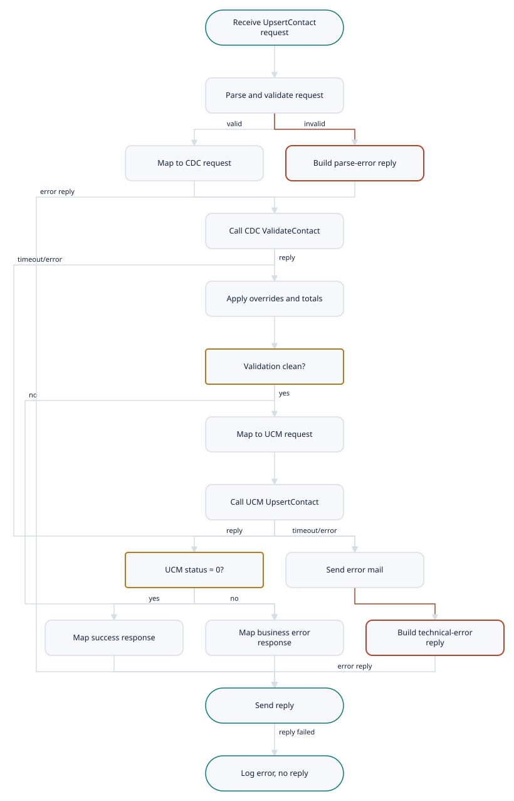

# CRMServices.UpsertContact (1046)

Demo-TIBCO-CMRService-Project · Listener · medium complexity

[← All interfaces](../../Extraction_Report.md)

- [Interface Overview](#interface-overview)
- [Interface Summary](#interface-summary)
- [Functional Analysis](#functional-analysis)
- [Technical Analysis](#technical-analysis)
- [Mappings](#mappings)
- [Business Rules](#business-rules)
- [Flow Diagram](#flow-diagram)
- [Data Model](#data-model)
- [Architecture](#architecture)

---

## Interface Overview

A synchronous request/reply service (KPN EAI service 1046 'UpsertContact', contract 0426). It receives a contact person, first has it validated by CDCAdapter (ValidateContact, contract 0425) and, only if the validation reports no warnings, no errors and status 0, creates or updates the contact in UCM through UCMAdapter (UpsertContact, contract 0430). The caller receives the outcome: success with UCM's returned contact data, or the validation or UCM result explaining why the contact was not stored.

| Field | Value |
| --- | --- |
| Interface | CRMServices.UpsertContact (1046) |
| Type | Listener |
| Complexity | medium |
| Components to build | 17 |
| Mapping rules | 38 |
| Business rules | 7 |

## Interface Summary

UpsertContact is the service front-end applications use to create or update a contact person in UCM. Each request is first checked by a validation service (CDCAdapter), which reports warnings and errors for the person and for each address. Only a clean result lets the contact through to UCM. The caller can mark the contact, or individual addresses, with an override flag to accept warnings. Errors cannot be overridden.  The caller always receives a reply. On success, it contains the contact as stored by UCM. If validation stops the contact, the reply carries the validation status and details. If UCM rejects it, the reply carries UCM's status. Only technical failures (an unreadable request, a timeout or an unexpected error) produce a 'Technical Error' reply and, after a successful parse, an e-mail to integration support.  The business logic is moderate: two calls in sequence, some decisions and a counting rule. The mappings are large but mostly straight copies. As with the rest of CRMServices, the main obstacles are the TIBCO Rendezvous transport, which Boomi cannot use, and the missing header schemas. One counting rule also behaves in a way that may be a defect, and it needs a business decision before it is copied.

**Complexity:** medium (score 56)

## Functional Analysis

1. **Receive request** — RV Subscriber on %%Env%%.FIXED.CRM.%%CRMServices/ComponentId%%.Request.UpsertContact.1 (RVCMQ); body in RV field 'xml'; reply subject captured.
2. **Trace request (optional)** — If eai:isTraceOn('EAI-04005') is true, log via Common Sub\_Trace.
3. **Parse and validate request** — Parse as UpsertContactRequest (0426) with validateOutput = true.
4. **Rebuild header for implementation** — Main\_UpsertContact rebuilds the CMH (ID '1046', NAME 'UpsertContact', MID '1046.20', TO copied from request, new ITEM EVENT 'UpsertContact'), copies BODY and passes ReplyDestination.
5. **Map to CDC ValidateContact** — Build ValidateContactRequest: CMH ID '1046', NAME 'ValidateContact'; ADDRESS/@language 'nl'; STREET\_NAME/@namingConvention 'PROPRIETARY'; OVERRIDE\_VALIDATION default false.
6. **Call CDC ValidateContact** — Common Sub\_Requester to the CMH TO destination, timeout CRMServices/RV/Timeout (5000 ms); reply parsed and validated as ValidateContactResponse.
7. **Apply overrides and totals** — Copy CMH and RESULT\_STATUS. If BODY exists: apply contact-level and per-address OVERRIDE\_VALIDATION to warning counts; compute VALIDATION\_TOTAL\_WARNING\_COUNT and VALIDATION\_TOTAL\_ERROR\_COUNT.
8. **Validation passed?** — Proceed only if TOTAL\_WARNING\_COUNT exists and = 0, TOTAL\_ERROR\_COUNT exists and = 0, and RESULT\_STATUS/@STATUS = 0; otherwise build the error response from CDC.
9. **Map to UCM UpsertContact** — Build UCM UpsertContactRequest from the validated CDC CONTACT\_PERSON; DESTINATION %%Env%%.FIXED.CRM.UCMAdapter.Request.UpsertContact.1.
10. **Call UCM UpsertContact** — Common Sub\_Requester, timeout 5000 ms; reply parsed as UCM UpsertContactResponse.
11. **UCM status = 0?** — If RESULT\_STATUS/@STATUS != 0, build the error response from UCM; otherwise build the success response.
12. **Build response** — UpsertContactResponse: CMH (ID 1048), RESULT\_STATUS (STATUS '0' 'No Error', or the error-response status) and BODY (error-response BODY, or UCM CONTACT\_PERSON).
13. **Reply** — Optional trace (EAI-04006), then RV reply with the rendered response.
14. **Technical error path** — Implementation failure: mail 'Error in UpsertContact', then ErrorReply. Parse failure: ErrorReply without mail. The starter logs the error and replies with ErrorReply/Body when present.

## Technical Analysis

| Direction | Protocol | Address | Authentication |
| --- | --- | --- | --- |
| inbound | TIBCO Rendezvous request/reply (RVCMQ) | %%Env%%.FIXED.CRM.%%CRMServices/ComponentId%%.Request.UpsertContact.1 (default XDVL.FIXED.CRM.CRMServices.Request.UpsertContact.1) | none visible (network and subject segregation) |
| outbound | TIBCO Rendezvous request/reply via Common Sub\_Requester | %%Env%%.FIXED.CRM.CDCAdapter.Request.ValidateContact.1 | none visible |
| outbound | TIBCO Rendezvous request/reply via Common Sub\_Requester | %%Env%%.FIXED.CRM.UCMAdapter.Request.UpsertContact.1 | none visible |

## Mappings

| Rule ID | Mapping | Target field | Source | Type | Condition | Function | Complexity | Notes |
| --- | --- | --- | --- | --- | --- | --- | --- | --- |
| MR-001 | UpsertContactRequest to CDC ValidateContactRequest | CMH/ID, NAME, MID, PARADIGM, OBJECT, VERSION | constants | hardcoded | — | '1046', 'ValidateContact', '1046.20', 'REQUEST', 'CONTACT\_PERSON', '1.0' | low | — |
| MR-002 | UpsertContactRequest to CDC ValidateContactRequest | CMH/TO/@DESTINATION | Env | calculated | — | concat(Env,'.FIXED.CRM.CDCAdapter.Request.ValidateContact.1') | low | — |
| MR-003 | UpsertContactRequest to CDC ValidateContactRequest | CMH/TRACKING | UpsertContactRequest/CMH/TRACKING | transformed | — | MESSAGE\_ID copied; ITEMs copied + new ITEM (APPINFO concat(ComponentDomain,'/',ComponentId,'/',ComponentVersion), EVENT 'ValidateContact', TIMESTAMP); SEQUENCE\_NO for-each | low | APPINFO includes the version in this flow. |
| MR-004 | UpsertContactRequest to CDC ValidateContactRequest | BODY/CONTACT\_PERSON (scalar fields) | UpsertContactRequest/BODY/CONTACT\_PERSON | passthrough | — | copy | low | Same ContactPerson\_Type in both namespaces. |
| MR-005 | UpsertContactRequest to CDC ValidateContactRequest | BODY/CONTACT\_PERSON/ADDRESS/@language | constant | hardcoded | for each ADDRESS | 'nl' | low | — |
| MR-006 | UpsertContactRequest to CDC ValidateContactRequest | BODY/CONTACT\_PERSON/ADDRESS/OVERRIDE\_VALIDATION | ADDRESS/OVERRIDE\_VALIDATION | conditional | absent in request | if (exists(OVERRIDE\_VALIDATION)) then OVERRIDE\_VALIDATION else false() | low | Boomi: Default Value 'false'. |
| MR-007 | UpsertContactRequest to CDC ValidateContactRequest | BODY/CONTACT\_PERSON/ADDRESS/STREET\_NAME/@namingConvention | constant | hardcoded | — | 'PROPRIETARY' | low | Overrides any convention sent by the caller. |
| MR-008 | UpsertContactRequest to CDC ValidateContactRequest | BODY/CONTACT\_PERSON/ADDRESS/UNFORMATTED\_ADDRESS/ADDRESS\_LINE (@sequenceNumber) | ADDRESS/UNFORMATTED\_ADDRESS/ADDRESS\_LINE | looped | — | for-each | low | — |
| MR-009 | UpsertContactRequest to CDC ValidateContactRequest | BODY/CONTACT\_PERSON/SIEBEL\_ACCOUNT\_REFERENCE | CONTACT\_PERSON/SIEBEL\_ACCOUNT\_REFERENCE | looped | — | for-each | low | — |
| MR-010 | CDC response post-processing (override and totals) | CMH, RESULT\_STATUS | ValidateContactResponse/CMH, RESULT\_STATUS | passthrough | — | copy-of | low | — |
| MR-011 | CDC response post-processing (override and totals) | BODY/CONTACT\_PERSON/VALIDATION\_WARNING\_COUNT | response VALIDATION\_WARNING\_COUNT; request CONTACT\_PERSON/OVERRIDE\_VALIDATION | conditional | request OVERRIDE\_VALIDATION = 'true' | '0' else response value (if present) | medium | — |
| MR-012 | CDC response post-processing (override and totals) | BODY/CONTACT\_PERSON/VALIDATION\_TOTAL\_WARNING\_COUNT | contact and ADDRESS VALIDATION\_WARNING\_COUNT | calculated | (contact WARNING\_COUNT \> 0) or (contact ERROR\_COUNT \> 0); else '0' | number(contact VALIDATION\_WARNING\_COUNT) + sum(ADDRESS/VALIDATION\_WARNING\_COUNT) | high | Uses the raw response counts, not the overridden ones. Groovy map function. |
| MR-013 | CDC response post-processing (override and totals) | BODY/CONTACT\_PERSON/VALIDATION\_TOTAL\_ERROR\_COUNT | contact and ADDRESS VALIDATION\_ERROR\_COUNT | calculated | same condition as MR-012 | number(contact VALIDATION\_ERROR\_COUNT) + sum(ADDRESS/VALIDATION\_ERROR\_COUNT) | high | — |
| MR-014 | CDC response post-processing (override and totals) | BODY/CONTACT\_PERSON/ADDRESS\[n\]/VALIDATION\_WARNING\_COUNT | response ADDRESS\[n\]; request ADDRESS\[n\]/OVERRIDE\_VALIDATION | conditional | request ADDRESS at the same position has OVERRIDE\_VALIDATION = 'true' | '0' else response value | medium | Positional match ($IDX = position()). |
| MR-015 | CDC response post-processing (override and totals) | BODY/CONTACT\_PERSON/{CONTACT\_MEDIUM, VALIDATION\_RESULT, ADDRESS (other fields, ADDRESS\_LINE, RUNTIME\_PARAMETERS, VALIDITY, VALIDATION\_RESULT), SIEBEL\_ACCOUNT\_REFERENCE} | same paths in response | passthrough | — | copy-of / for-each | low | — |
| MR-016 | CDC validated contact to UCM UpsertContactRequest | CMH/ID, NAME, MID, PARADIGM, OBJECT, VERSION | constants | hardcoded | — | '1046', 'ValidateContact', '1046.20', 'REQUEST', 'CONTACT\_PERSON', '1.0' | low | NAME is 'ValidateContact' even though this is the UCM UpsertContact request; reproduce unless the client agrees to change it. |
| MR-017 | CDC validated contact to UCM UpsertContactRequest | CMH/TO/@DESTINATION | Env | calculated | — | concat(Env,'.FIXED.CRM.UCMAdapter.Request.UpsertContact.1') | low | — |
| MR-018 | CDC validated contact to UCM UpsertContactRequest | CMH/TRACKING | ValidateContactResponse/CMH/TRACKING | transformed | — | MESSAGE\_ID, ITEMs, SEQUENCE\_NO copied + new ITEM (APPINFO concat(ComponentDomain,'/',ComponentId) without version, EVENT 'ValidateContact') | low | — |
| MR-019 | CDC validated contact to UCM UpsertContactRequest | BODY/CONTACT\_PERSON/{VALIDATION\_WARNING\_COUNT, VALIDATION\_ERROR\_COUNT, VALIDATION\_TOTAL\_WARNING\_COUNT, VALIDATION\_TOTAL\_ERROR\_COUNT, CONTACT\_PERSON\_ID, INITIALS, FAMILY\_NAME\_PREFIX, FAMILY\_NAME, FAMILY\_NAME\_POSTFIX, PREFERRED\_NAME, DATE\_OF\_BIRTH, ACADEMIC\_TITLE} | same-named CDC response elements | conditional | copied if present | — | low | — |
| MR-020 | CDC validated contact to UCM UpsertContactRequest | BODY/CONTACT\_PERSON/CONTACT\_MEDIUM/{TELEPHONE, FAX, EMAIL\_ADDRESS, USAGE/SUPPRESS\_ALL\_EMAILS} | CDC CONTACT\_MEDIUM | conditional | copied if present | — | low | — |
| MR-021 | CDC validated contact to UCM UpsertContactRequest | BODY/CONTACT\_PERSON/VALIDATION\_RESULT/{SEVERITY, CODE, DESCRIPTION} | CDC VALIDATION\_RESULT | looped | — | for-each | low | — |
| MR-022 | CDC validated contact to UCM UpsertContactRequest | BODY/CONTACT\_PERSON/ADDRESS (@language, VALIDATION\_WARNING\_COUNT, VALIDATION\_ERROR\_COUNT, STREET\_NAME/@namingConvention, HOUSE\_NUMBER, HOUSE\_NUMBER\_EXTENSION, POSTCODE, CITY\_NAME, COUNTRY, COUNTRY\_CODE, ADDRESS\_TYPE, LOCATION\_DESCRIPTION, UNFORMATTED\_ADDRESS/ADDRESS\_LINE, RUNTIME\_PARAMETERS/{SPECIAL\_DESCRIPTION, POSTCODE\_SUFFIX, IS\_FUTURE\_PRIMARY\_ADDRESS, IS\_PRIMARY\_LOGICAL\_ADDRESS, IS\_PRIMARY\_MULTI\_VALUE\_GROUP}, VALIDITY/{ADDRESS\_STATUS, VALID\_FROM\_DATE, VALID\_UNTIL\_DATE}, VALIDATION\_RESULT) | CDC ADDRESS | looped | fields copied if present; STREET\_NAME and COUNTRY\_CODE always written | for-each | medium | — |
| MR-023 | CDC validated contact to UCM UpsertContactRequest | BODY/CONTACT\_PERSON/SIEBEL\_ACCOUNT\_REFERENCE/{SIEBEL\_ACCOUNT\_ID, UCM\_ROW\_ID, INTEGRATION\_ID} | CDC SIEBEL\_ACCOUNT\_REFERENCE | looped | fields copied if present | for-each | low | — |
| MR-024 | CDC validated contact to UCM UpsertContactRequest | BODY/CONTACT\_PERSON/RUNTIME\_PARAMETERS/{INTEGRATION\_ID, ID} | CDC RUNTIME\_PARAMETERS | conditional | copied if present | — | low | UCM\_ROW\_ID and IS\_PRIMARY\_MULTI\_VALUE\_GROUP are not observed in this mapping; confirm during build. |
| MR-025 | Response to caller | CMH/ID, NAME, MID, PARADIGM, OBJECT, VERSION | constants | hardcoded | — | 1048, 'UpsertContact', '1046.20', 'REQUEST', 'CONTACT\_PERSON', '1.0' | low | Reply ID 1048 and PARADIGM 'REQUEST' as in source. |
| MR-026 | Response to caller | CMH/FID | UCM UpsertContactResponse/CMH/FID | conditional | present | — | low | — |
| MR-027 | Response to caller | CMH/FROM/@COMPONENT\_ID, @COMPONENT\_VERSION | ComponentId, ComponentVersion | hardcoded | — | — | low | — |
| MR-028 | Response to caller | CMH/TO/@DESTINATION | ReplyDestination (RV reply subject) | transformed | — | copy | low | JMSReplyTo in the target design. |
| MR-029 | Response to caller | CMH/TRACKING | original request CMH/TRACKING | transformed | EXTERNAL\_REF if present | MESSAGE\_ID, EXTERNAL\_REF, ITEMs, SEQUENCE\_NO copied + new ITEM (APPINFO with version, EVENT 'UpsertContact') | low | — |
| MR-030 | Response to caller | RESULT\_STATUS | error-response RESULT\_STATUS or constants | conditional | error response exists -\> copy its RESULT\_STATUS; else success | success: STATUS '0', ERROR\_DESCRIPTION 'No Error' | low | — |
| MR-031 | Response to caller | BODY | error-response BODY, else UCM response BODY/CONTACT\_PERSON | conditional | error-response BODY exists -\> copy; else if UCM BODY exists -\> field-by-field copy of CONTACT\_PERSON (incl. RUNTIME\_PARAMETERS INTEGRATION\_ID/UCM\_ROW\_ID/ID and CROSS\_REFERENCE CONTACT\_ID/CIF\_SYSTEM\_ID/EXTERNAL\_ID1/SYSTEM\_NAME/SYSTEM\_NUMBER) | — | medium | No BODY when neither exists. |
| MR-032 | Business error response (Map Error Response) | CMH | constants and request TRACKING | hardcoded | — | ID 1048, NAME 'UpsertContact', MID '1046.20', PARADIGM 'REQUEST', OBJECT 'CONTACT\_PERSON', TO = ReplyDestination, EVENT 'UpsertContact' | low | — |
| MR-033 | Business error response (Map Error Response) | RESULT\_STATUS | CDC or UCM RESULT\_STATUS | conditional | CDC BODY exists and CDC STATUS != 0 -\> CDC; else UCM BODY exists and UCM STATUS != 0 -\> UCM; else STATUS 1 'General Un-Attribute Error' | copy STATUS; MSG\_CODE, ERROR\_CODE, ERROR\_DESCRIPTION if present | medium | — |
| MR-034 | Business error response (Map Error Response) | BODY | CDC response BODY or UCM response BODY | conditional | CDC BODY exists and CDC STATUS != 0 -\> CDC BODY; else UCM BODY exists and UCM STATUS != 0 -\> UCM BODY; no otherwise branch | field-by-field copy | medium | When CDC status is 0 but warnings or errors stop the contact, no BODY is produced, so the caller does not see which validation failed. |
| MR-035 | Technical error reply | CMH | constants + parsed request TRACKING | hardcoded | — | ID 1048, NAME 'UpsertContact', MID '1046.20', PARADIGM 'REQUEST', OBJECT 'CONTACT\_PERSON', VERSION '1.0', EVENT 'UpsertContact' | low | — |
| MR-036 | Technical error reply | RESULT\_STATUS | constants | conditional | parse error -\> STATUS 1 'Technical Error'; otherwise STATUS 1 'General Un-Attribute Error' | — | low | — |
| MR-037 | Technical error reply | Errors/Error/MsgCode | constants / fault | conditional | parse error -\> CRMS-03011 (Params = raw request); implementation error -\> copy fault Errors, else CRMS-03000 | — | low | Errors go to the error log only, not to the caller. |
| MR-038 | Technical error reply | Error mail Subject / Body | error, parsed request | calculated | implementation error | Subject 'Error in UpsertContact'; Body concat('Location :upsertContact', first Errors/MsgCode else Result\_Status/@ERROR\_DESCRIPTION, 'Message Causing Error is : ', render-xml(request)) | low | Sent via crm-shared-framework. |

_The same rows are in `Mappings.csv`, which opens in Excel._

## Business Rules

| ID | Rule | Logic | Priority |
| --- | --- | --- | --- |
| BR-001 | Contact must pass CDC validation before UCM upsert | Proceed to UCM only if VALIDATION\_TOTAL\_WARNING\_COUNT exists and = 0, VALIDATION\_TOTAL\_ERROR\_COUNT exists and = 0, and RESULT\_STATUS/@STATUS = 0. Otherwise return the CDC result to the caller. | High |
| BR-002 | Validation override | CONTACT\_PERSON/OVERRIDE\_VALIDATION = 'true' forces the contact VALIDATION\_WARNING\_COUNT to 0. ADDRESS\[n\]/OVERRIDE\_VALIDATION = 'true' forces the n-th returned address's warning count to 0. Errors are never overridden. | Medium |
| BR-003 | Validation totals | TOTAL\_WARNING = contact WARNING + sum(address WARNING); TOTAL\_ERROR = contact ERROR + sum(address ERROR). Computed only when the contact-level warning or error count \> 0; otherwise both totals are 0. Totals use the raw (not overridden) response counts. | High |
| BR-004 | Default address attributes | Every address sent to CDC is tagged language 'nl' and street-name convention 'PROPRIETARY'; a missing address override defaults to false. | Low |
| BR-005 | UCM rejection returned to caller | If UCM RESULT\_STATUS/@STATUS != 0, reply with UCM's status and BODY; not treated as a technical error (no mail). | High |
| BR-006 | Error mail only on technical failure after parse | Mail 'Error in UpsertContact' is sent when the implementation sub-process faults; not for parse errors, nor for CDC or UCM business rejections. | Medium |
| BR-007 | Request must be schema-valid | Parse with validation; failure gives STATUS 1 'Technical Error' (CRMS-03011). | Medium |

## Flow Diagram

1. **Receive UpsertContact request** — BW: RV ...Request.UpsertContact.1. Boomi (assumed): uc-listen-op.
2. **Parse and validate request** — 0426 UpsertContactRequest; cache the request in the Document Cache.
3. **Map to CDC request** — uc-req-to-cdc-map; language 'nl', PROPRIETARY.
4. **Build parse-error reply** — STATUS 1 'Technical Error'; CRMS-03011; no mail.
5. **Call CDC ValidateContact** — Timeout 5000 ms.
6. **Apply overrides and totals** — uc-cdc-postprocess-map + uc-validation-totals-fn.
7. **Validation clean?** — TOTAL\_WARNING = 0 and TOTAL\_ERROR = 0 and STATUS = 0.
8. **Map to UCM request** — uc-cdc-to-ucm-map.
9. **Call UCM UpsertContact** — Timeout 5000 ms.
10. **UCM status = 0?**
11. **Send error mail** — Sub: CRM Send Error Mail (crm-shared-framework).
12. **Map success response** — STATUS 0 'No Error' + UCM CONTACT\_PERSON.
13. **Map business error response** — uc-error-response-map: CDC or UCM status and BODY.
14. **Build technical-error reply** — STATUS 1 'General Un-Attribute Error'.
15. **Send reply** — uc-reply-op.
16. **Log error, no reply** — When the reply fails.

## Data Model

| Profile | Format | Component |
| --- | --- | --- |
| CRM Contact UPSERT Req XML Prof | xml | uc-request-prof |
| CRM Contact UPSERT Resp XML Prof | xml | uc-response-prof |
| CDC Contact VALIDATE Req XML Prof | xml | uc-cdc-validate-req-prof |
| CDC Contact VALIDATE Resp XML Prof | xml | uc-cdc-validate-resp-prof |
| UCM Contact UPSERT Req XML Prof | xml | uc-ucm-upsert-req-prof |
| UCM Contact UPSERT Resp XML Prof | xml | uc-ucm-upsert-resp-prof |

## Architecture

**How the legacy pieces map to Boomi**

| Legacy | Boomi |
| --- | --- |
| Reply\_UpsertContactRV RV Subscriber + RV Reply | uc-listen-op + uc-reply-op (JMS, assumed) |
| Main\_UpsertContact Parse Request + header rebuild | Profile parse in Try; Set Properties |
| Call CDCAdapter input mapping | uc-req-to-cdc-map |
| \_Sub\_ValidateContact (Sub\_Requester + Parse XML) | uc-cdc-validate-op |
| \_Sub\_ValidateContact Map Data | uc-cdc-postprocess-map + uc-validation-totals-fn |
| 'No Error or Warning' transition | Decision shape |
| Map Data (CDC to UCM) | uc-cdc-to-ucm-map |
| \_sub\_UpsertContact (Sub\_Requester + Parse XML) | uc-ucm-upsert-op |
| Map Error Response | uc-error-response-map |
| Sub\_UpsertContact\_UpsertContact return bindings | uc-ucm-to-response-map |
| Main\_UpsertContact Throw Exception + Send Error Mail | Catch path: shared-sub-send-error-mail + technical-error map |

**Components**

| Component | Role |
| --- | --- |
| uc-request-prof | Inbound request profile |
| uc-response-prof | Reply profile |
| uc-listen-op | Inbound listener |
| uc-reply-op | Reply to caller |
| uc-cdc-validate-req-prof | CDC request profile |
| uc-cdc-validate-resp-prof | CDC response profile |
| uc-cdc-validate-op | CDC ValidateContact request/reply |
| uc-ucm-upsert-req-prof | UCM request profile |
| uc-ucm-upsert-resp-prof | UCM response profile |
| uc-ucm-upsert-op | UCM UpsertContact request/reply |
| uc-req-to-cdc-map | Request to CDC |
| uc-validation-totals-fn | Override and totals logic |
| uc-cdc-postprocess-map | CDC response post-processing |
| uc-cdc-to-ucm-map | Validated contact to UCM |
| uc-ucm-to-response-map | Success reply |
| uc-error-response-map | Business error reply |
| uc-main-process | Listener process |

## Client questions

- **Q-001** Which applications call UpsertContact today, and can they move from TIBCO Rendezvous to EMS request/reply or to an HTTP API?
  **If this is not answered:** Callers move to an EMS request queue named like today's subject (\<Env\>.FIXED.CRM.CRMServices.Request.UpsertContact.1), with the same decision as GetAccountData.
- **Q-002** Should warnings or errors reported only on a contact's addresses (with none on the person) stop the contact from being saved in UCM?
  **If this is not answered:** Today's behaviour is replicated exactly: address-only findings do not stop the upsert.
- **Q-003** When a contact is marked 'override validation', should the override also stop contact-level warnings from counting towards the total that blocks the save?
  **If this is not answered:** Today's behaviour is replicated: totals use the raw counts.
- **Q-004** When validation stops a contact but the validation service reports success status, should the caller receive the validation details instead of the generic 'General Un-Attribute Error' with no details that it gets today?
  **If this is not answered:** Today's reply is replicated exactly: STATUS 1, 'General Un-Attribute Error', no BODY.
- **Q-005** Does the validation service always return a contact's addresses in the same order as they were sent?
  **If this is not answered:** Order is preserved, and addresses are matched by position as today.
- **Q-006** Should every address still be sent for validation as Dutch-language with the 'proprietary' street-naming convention, whatever the caller supplied?
  **If this is not answered:** The hard-coded values are kept.
- **Q-007** Which system sits behind the CDC validation service, and who owns it?
  **If this is not answered:** CDCAdapter is reached the same way as UCMAdapter (the shared transport decision), with no change to its message format.
- **Q-008** Do any callers depend on the reply header fields as they are today (reply ID 1048 with type 'REQUEST'), or may they be corrected to a response type?
  **If this is not answered:** Header values are reproduced exactly as today.
- **Q-009** How long do callers wait for an UpsertContact reply, and how many requests per day and per peak hour are expected?
  **If this is not answered:** Callers wait at least 15 seconds; low volume; low-latency mode on a single runtime.
